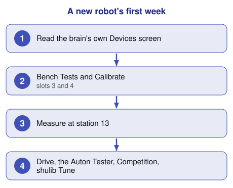

# shulib

shulib is the code that runs Seton Hall's VEX U robots. It knows where the robot is, drives it there,
runs its lifts, claws and flippers, and tells you what happened.

## What do you want to do?

| I want to… | Go to |
|---|---|
| Drive the robot | [Build and upload the programs](guide/07-getting-set-up.md) · [Buttons for your mechanisms](cookbook/06-driver-control.md) · [Set the buttons and the stick feel by clicking](guide/22-making-your-first-route.md#the-drivers-buttons-and-the-driving-feel) · [Match day](guide/17-the-competition-program.md) |
| Write a skills route | [The field](guide/02-the-field-and-coordinates.md) · [The steps of a route](guide/09-the-recipe-api.md) · [Try it before the field](guide/16-testing-an-auton-on-the-bench.md) |
| Add or tune a mechanism | [Declare a mechanism](guide/18-mechanisms.md) · [Tune it on the robot](guide/18-mechanisms.md#the-tune-program--tuning-on-the-brain-screen) · [Protect a string lift](guide/18-mechanisms.md#current-caps--how-hard-a-string-is-pulled) |
| Set up a new robot | [Add your robot](guide/21-adding-your-robot-by-hand.md) · [The robot facts form](robot-facts-form.md) · [Check every motor and sensor](guide/21-adding-your-robot-by-hand.md#the-order-on-the-robot) · [Calibrate the drive](guide/19-calibrating-your-robot.md) |
| Check the robot on the bench | [The order on the robot](guide/21-adding-your-robot-by-hand.md#the-order-on-the-robot) · [Try a route on the bench](guide/16-testing-an-auton-on-the-bench.md) |
| Understand an error or a log line | [Reading the log](guide/11-reading-the-diagnostics.md) · [When things go wrong](guide/12-when-things-go-wrong.md) · [What it cannot do yet](guide/14-what-it-cannot-do-yet.md) · [FAQ](faq.md) |
| Teach or mentor | [How it works](guide/README.md) (the ideas in order, before any code) · [Glossary](guide/15-glossary.md) |
| Maintain the library | [Extend the library](guide/13-extending-the-library.md) · [How these pages stay true](how-the-docs-stay-true.md) · [API reference](api/README.md) · [Changelog](changelog.md) · [Roadmap](roadmap.md) |

A new robot's first week, in the order of [The order on the robot](guide/21-adding-your-robot-by-hand.md#the-order-on-the-robot):

## Why this library exists

Most VEX teams use LemLib, which drives only tank robots. Our robots have been X-drive and H-drive,
which LemLib cannot drive at all — that is why this exists. This season both of our robots are
tanks, and shulib drives them as well.

It is built around three questions a robot answers all the time:

- **Where am I** — odometry fused with the inertial sensor, corrected against field walls and, when
  available, a GPS or AprilTags.
- **How do I get over there** — motion that can translate and turn at the same time (an X-drive or
  H-drive robot can slide sideways, so the library is built around that rather than treating it as
  an afterthought); it drives tank robots too.
- **What just happened** — a plain record of every step, plus a blackbox log that survives without
  a laptop.

## How these pages stay true

- **Every code example compiles and runs** — the pages quote it word for word.
- **The API reference is regenerated from the code** — the build fails if it is stale or incomplete.
- **The parts teams build on are frozen** — changing one fails the build, naming the rule it broke.

More: [How these pages stay true](how-the-docs-stay-true.md).

---

*Source: [github.com/SHU-ROBOTICS/shulib](https://github.com/SHU-ROBOTICS/shulib)*
