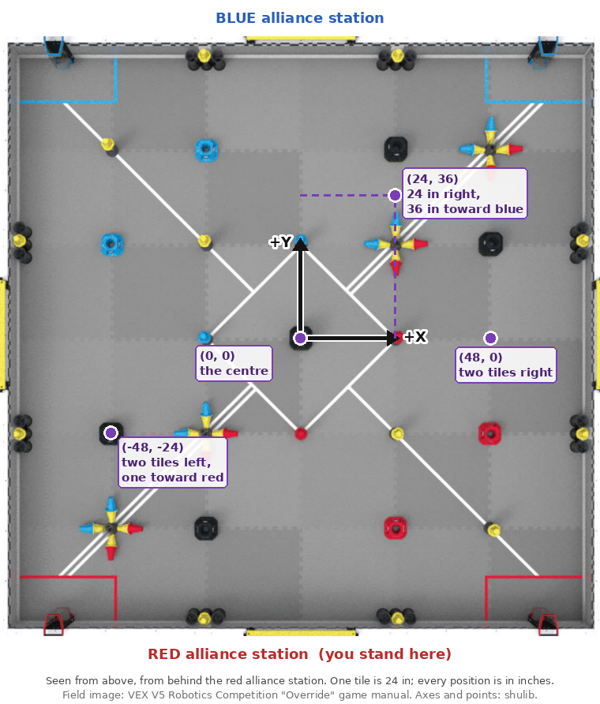
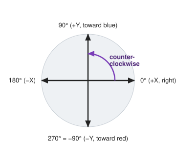

# 2 — The field and coordinates

> **Covers:** how positions on the field are described, what a *pose* is, and the difference
> between field-relative and robot-relative — the single most common source of confusion in
> all of robot programming.
> **Read this if:** you're going to write or read any autonomous code. Do not skip this one.
> **Assumes:** [Chapter 1](01-what-is-this.md). No code, no math beyond a right triangle.

## Describing a spot on the field

To tell a robot "go there," you need a way to name "there." We use coordinates, exactly like a
graph in math class:

- **(0, 0) is the center of the field.**
- **+X points to the right, +Y points away from the red alliance station** — as seen by the
  audience.
- Distances are in **inches**. The field is 12 feet square, so coordinates run from about −70
  to +70 in each direction. Field tiles are 24 inches on a side, which makes them a handy mental
  ruler: "two tiles right of center" is x = 48.

So (24, 36) means: 24 inches right of center, 36 inches toward the far side. Every position in
every routine, every log line, and every test is written this way.



One convention, applied everywhere, matters more than which convention it is. The single worst
class of robot bug is two pieces of code silently disagreeing about what the numbers mean — one
thinks Y points left, another thinks Y points forward, and the robot drives somewhere confidently
wrong. shulib's rule is that there is exactly **one** coordinate convention, it is written down
once (master plan, [§7 Canonical Conventions](../shulib-v2-master-plan.md#7-canonical-conventions)),
and every sensor's raw output is converted to it in exactly one place. You never have to convert
anything yourself.

## Heading: which way the robot faces

Position isn't enough — a robot at (24, 36) facing the goal and a robot at (24, 36) facing away
from it are in very different situations. The direction a robot faces is called its **heading**,
measured as an angle:

- **0° points along +X** (to the right, from the audience's view).
- Angles increase **counterclockwise**: 90° points along +Y, 180° points along −X.



This is the standard math-class convention. Note that it is *not* the compass convention
(compasses put 0 at north and go clockwise) — the V5's inertial sensor actually reports
compass-style angles, and the library converts them at the boundary so you never see them.
In your code, angles are written in degrees (`90_deg`); internally the library computes in
radians. You don't need to care, but you'll see the word "radians" in some output.

One more thing about angles, because it bites everyone eventually: angles wrap around. 359° and
−1° are the same direction. If the robot is facing 170° and you tell it to face −170°, the
correct move is to turn 20° further counterclockwise (through 180°), not to turn 340° the other
way. The library always computes the *shortest* turn, and its `Angle` type handles wrapping
everywhere, so "the robot spun the long way around" is a bug class that shouldn't exist here.

## Pose = position + heading

A **pose** is the bundle of all three numbers: x, y, and heading. `(24, 36, 90°)` reads as "at
x = 24, y = 36, facing 90°." The word appears constantly — in code (`Pose2d`), in logs, in this
guide — and it always means exactly this triple.

Why bundle them? Because heading is not a detail — it is the part that ruins everything when it's
wrong. Here's the thing to internalize: **a position error stays put, but a heading error grows.**
If the robot's position estimate is an inch off, it's an inch off. If its heading estimate is 5°
off, then every foot it drives adds about an inch of *new* position error, in a direction the
robot cannot see. This is why the team's accuracy spec treats heading as the hard requirement
(the target is under 1° — see the spec in
[`hardware-assumptions.md`](../hardware-assumptions.md) and the master plan) and why so much of
the library's machinery exists to protect the heading estimate specifically.

## Field-relative vs robot-relative — spend real time here

This is the most common point of confusion, and it's worth slowing down for, because a reader who
*understands* it will never mix the two up, while a reader who memorized a rule will.

There are two natural ways to describe a direction:

- **Field-relative** (the library calls it the **Field frame**): directions are fixed to the
  field. "+Y" always means "toward the far side of the field," no matter which way any robot is
  facing. The field doesn't move, so field directions never change.
- **Robot-relative** (the **Body frame**): directions are fixed to the robot. "Forward" means
  "whichever way the robot's front is pointing *right now*." When the robot turns, robot-relative
  directions turn with it.

The confusing part is that both feel natural in different situations, so both exist and both are
used. Targets are naturally field-relative — "the goal is at (24, 36)" is true regardless of what
the robot is doing. Driving is naturally robot-relative — a joystick pushed forward means "go the
way you're facing."

Here is the example that makes it click. The robot sits at the center of the field, and you
command "drive in the +Y direction at 20 inches per second."

- If the robot is **facing 90°** (its front points along +Y), the two interpretations agree: it
  drives toward the far side, nose first. You cannot tell the frames apart. This is exactly why
  the bug hides — everything works in the simple test setup.
- Now suppose the robot is **facing 0°** (its front points along +X). If your command was
  **field-relative**, the robot slides toward the far side of the field *sideways*, left flank
  first — our robots can do that (next chapter). If your command was **robot-relative** ("+Y" in
  the robot's own frame means "to my left"), the robot drives toward... also its left — which is
  the far side. Fine. But turn the robot to face 180°, and the same robot-relative command now
  drives it toward the **near** side — the exact opposite of the field-relative reading.

Same command, opposite motion, and the difference only shows up when the robot's heading differs
from the one you tested with. A frame mix-up is therefore a bug that *passes your test and fails
on the field*, which is what makes it so nasty. It gets worse: converting between the frames uses
the robot's heading estimate. If that estimate is wrong, every field-relative command is rotated
by the error — the robot doesn't just face the wrong way, it *translates* in the wrong direction,
everywhere, until something corrects the heading.

shulib's defense is to make the frame **impossible to leave unstated**. The one API call that
takes a raw velocity command, `drive(speeds, frame)`, requires you to write `Frame::Field` or
`Frame::Body` at the call site — there is no default, and leaving it out is a compile error, not
a runtime surprise. Every other motion call (`moveTo`, `turnTo`, ...) takes a field-relative
target by definition, and says so in its documentation. And the actual conversion math lives in
exactly one file ([`frame.hpp`](../../include/shulib/math/frame.hpp)), tested in both directions,
so no one ever re-derives a rotation by hand with a sign error.

What you should carry forward:

1. **Targets are field positions.** When you write `moveTo({24_in, 36_in, 90_deg})`, that pose is
   on the field, full stop.
2. **When a command is a velocity, always ask "in whose frame?"** The code will force you to
   answer; make sure your answer is a decision, not a guess.
3. **If the robot ever translates in a consistently wrong direction that depends on which way
   it's facing** — that's the signature of a frame or heading error. Chapter 12's
   troubleshooting section starts there.

## Where does the robot's "position" actually point?

One small thing worth knowing now, so it never surprises you: the robot is a big object, and its
"position" is the position of one specific point on it — the **tracking center**, the point the
position-tracking hardware measures (roughly the center of the drivetrain). When you send the
robot to (24, 36), that point goes to (24, 36); the arm, the intake, and the bumpers are wherever
the robot's geometry puts them. When a target "isn't quite where the game piece is," check
whether you're thinking about the tracking center or the front of the intake.

## The field's mirror: two robots, one route

In a VEX U skills run **both robots run at the same time**, and both start on red's side of the field
(the game manual's `<VURS2>` and `<VURS3>`). The rules also keep them out of each other's Quadrant
(`<SG1>`d) and on their own side of the Autonomous Line, the double diagonal tape (`<SG1>`f). In this
chapter's frame that line runs along y = x, and red's side holds exactly two Quadrants: the **red
wall's** and the **right wall's** (as seen from the red station). So robot one starts in one and
robot two in the other.

The manual's field drawing makes those two Quadrants **mirror images** of each other across the
OTHER diagonal — the one from the corner where the red wall meets the right wall to the corner where
the blue wall meets the left wall, the line **y = -x**. The goals, their colours, the Toggles (and
their Quadrants' colours), the skills setup's Pins and the tape all land on their own kind. So the
students write the skills route ONCE, for robot one, and robot two runs it mirrored
([Chapter 17](17-the-competition-program.md#two-robots-one-route-a-mirrored-auton) says how):

```text
                       BLUE wall (y = +70.2)
       (-70,70) +---------------------------------+ (70,70)
                |  \            blue's          / |
                |    \         Quadrant       /   |
                |      \                    /     |
       LEFT     |        \                /       |    RIGHT
       wall     |  blue's  \            /  robot  |    wall
                | Quadrant   \   (0,0) /    TWO's |
                |              \  O  /   Quadrant |
                |              /  \   (right wall)|
                |            /      \             |
                |          /  robot   \           |
                |        /    ONE's     \         |
                |      /     Quadrant     \       |
                |    /     (red wall)       \     |
                |  /                          \   |
      (-70,-70) +---------------------------------+ (70,-70)
                        RED wall (y = -70.2)
                        the red station is here

   /  the Autonomous Line, y = x: red's side is below and right of it
   \  THE MIRROR LINE, y = -x: robot one's Quadrant on one side, robot two's on the other
```

**The rule:** a point (x, y) facing h becomes **(-y, -x) facing -90° - h**. Worked through for a
start: robot one placed in the red wall's Quadrant at **(-36, -55.7) facing 0°** (along the red wall,
nose toward the right wall) is robot two at **(55.7, 36) facing -90°** (along the right wall, nose
toward the red wall). Headings, one by one:

| Robot one faces | Robot two faces | |
|---|---|---|
| 0° | -90° | |
| 90° | 180° | |
| 180° | 90° | |
| -90° | 0° | |
| 45° | -135° | |
| -45° | -45° | along the line itself: it is its own mirror |
| 135° | 135° | along the line the other way |

Every turn sweeps the OTHER way (that is a mirror). A point ON the line (x = -y) is its own image.

**It is not the usual left/right mirror.** "Mirrored" usually means x becomes -x. On this field that
sends robot two to the wrong goals (only 1 of the 9 keeps its colour) and does not keep red's side red;
the half turn swaps red and blue — it is the HEAD-TO-HEAD mirror, not this one.

**What the mirror cannot carry** — the library cannot see these, so it never guesses:

- **The Loaders** sit only on the red and blue walls; their images land on the right and left walls,
  where there are none. A step at a Loader has no mirror.
- **The Load Zones' colours:** the red/left corner's red zone lands on the blue/right corner's blue zone.
- **The robot itself is not mirrored.** A claw on robot one's left side is on robot two's LEFT side too —
  in the mirrored world, the wrong side. If the robot is built symmetric left to right, the mirror works;
  if not, the bench shows which steps need robot two's own numbers (A4 register HA-259).

**What lies ON the mirror line — the two robots' shared seam.** The mirror leaves its line where it is,
so whenever robot one reaches the line, robot two reaches **the same spot at the same moment**. On it sit
the **centre goal** (0, 0), **two yellow Pins** of the skills setup (about (23.5, -23.5) and (47, -47)),
and the **red/right corner's Load Zone**. A mirrored route keeps robot one's WHOLE robot at least
**3 in** off the line — then the two robots stay at least **6 in** apart, whatever their timing — and
sends only ONE robot to what lies on it
([Chapter 17](17-the-competition-program.md#both-robots-at-once) — the library's tests run the two robots
together and fail, naming the moment, when they come within 6 in):

```text
        robot one's side   |<- 3 in ->|<- 3 in ->|   robot two's side
                           |   the 6 in band     |
                           |   (the mirror line  |
                           |    in its middle)   |
```

The library's piece: `competition::override2026::kSkillsMirror`
([`override_mirror.hpp`](../../include/shulib/competition/override_mirror.hpp)), the reflection
`math::Reflection` ([`reflection.hpp`](../../include/shulib/math/reflection.hpp)). Every number here is the
manual's drawing, read on paper: an element may sit up to 1 in off nominal on the event's field
(A4 register HA-258), and nothing here has run on a robot.

## The exact signatures

Everything in this chapter has an exact spelling in the reference: [`Frame`](../api/frame.md) (and the two conversions between field and body), [`Pose2d`](../api/pose2d.md), [`Angle`](../api/angle.md), [`Twist2d` and `ChassisSpeeds`](../api/twist2d.md), [`Reflection`](../api/reflection.md) (the field's mirror), and the typed quantities themselves — [`Quantity`](../api/quantity.md) with its aliases (`Length`, `Time`, `Voltage`, …) and the [unit literals](../api/literals.md) that let you write `24_in` and `300_ms`.

---

*Next: [Chapter 3 — Knowing where you are](03-knowing-where-you-are.md)*
