# 22 — Making your first route with the route builder

**Do this first:** [Set up your robot first](23-set-up-your-robot-first.md) — Bench Tests and Calibrate on the
robot, before you make a route.

Watch it first — about 2 ¾ minutes, with a voice.

<video controls preload="metadata" poster="../../assets/video/make-a-route.jpg" src="../../assets/video/make-a-route.mp4" style="max-width:100%"></video>

Music: "Wallpaper" by Kevin MacLeod ([incompetech.com](https://incompetech.com)), licensed under [Creative Commons: By Attribution 4.0](https://creativecommons.org/licenses/by/4.0/). Voice: Kokoro.

The video shows the website's way. On the team laptop, steps 1 and 7 below are shorter: **Open the route builder**
from VS Code, then **Send to robot**.

The **route builder** is a web page where you build your team's routes — the skills route and any other you name —
by clicking on the real field, and get the C++ for the robot out of it. You place robot one's start, add steps — drive here, curve through there, open the
claw — and the page checks every step against the library's own rules as you go. When the route is right, you
export it into the robot's code. Every line it writes is commented in plain words; it is your route, and you
should be able to explain every line of it.

This chapter is in four parts: [your first route](#your-first-route), step by step;
[the driver's buttons and the driving feel](#the-drivers-buttons-and-the-driving-feel) — the **Controls** tab;
[the mechanisms on the robot](#the-mechanisms-on-the-robot) — the **Mechanisms** tab; and
[the reference](#the-reference) — every kind of step, every check, the shortcuts, and the project file.

The route and the buttons in the pictures are examples of **how to click**, not choices for the robot: where robot
one starts, where it goes and what each button does are your team's to decide.

## Your first route

### 1. Open it

On the team laptop: open the shulib folder in VS Code, then **Terminal → Run Task → Open the route builder**. The
route builder opens in your browser — any browser — already working in the shulib folder: nothing to connect, and
**Send to robot** at the top right. Keep its terminal open while you work (**Ctrl+C** there stops it).

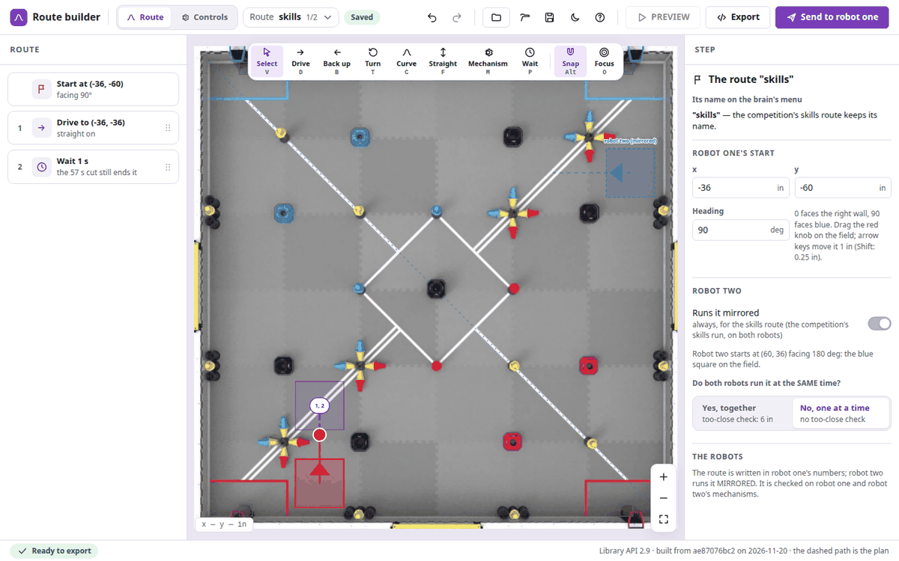

Open it once at home with the internet on: it keeps the robots' facts and PREVIEW for a venue with no internet. If
it says **Careful: the robots' facts are the published site's …**, tell the coordinator before you send.

**On a computer without the shulib folder:** open **docs.shurobotics.com** → **Route builder** → **Open the route
builder**. Edge or Chrome can write into a shulib folder you connect; Firefox downloads the project and copies the code
(Safari should do the same, but no test runs it). **Download for offline use** saves one file you double-click with no
internet.

The field is the real Override skills field, **red at the bottom** — you are looking at it from behind the red
alliance station, as in [chapter 2](02-the-field-and-coordinates.md). Every number is in **inches** from the field's
centre: **+x to the right, +y away from you (toward blue)**. Headings are in **degrees**: 0 faces the right wall,
90 faces blue, -90 faces red.

### 2. Place robot one's start

Click the field where robot one starts. Its 15 in square appears in red, its **front** marked with a triangle. Drag
the square to move it; drag the **red knob** in front of it to turn it (it snaps to 15°; hold **Shift** for 1°). The
numbers are on the right, to type exactly.

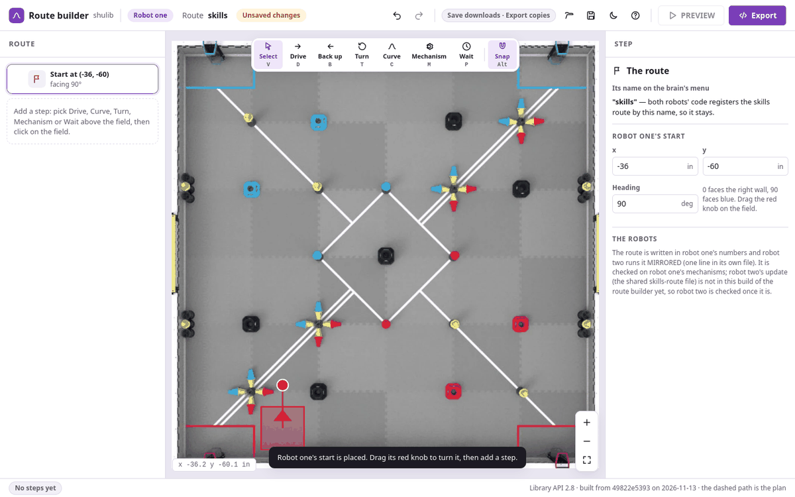

**Robot two on the field.** The skills route is **mirrored for robot two**: robot two runs it reflected across the
field's diagonal (the dotted blue line). Its start and its path are drawn in blue, labelled **robot two (mirrored)**,
so you always see where it goes. On the right, the route asks once: **do both robots run it at the same time?**

- **Yes, together** (a skills run with both robots): the page checks that its plan keeps the two robots' squares
  **6 in apart** all the way, the start included — the plan, not the field: run them together slowly first
  ([chapter 17](17-the-competition-program.md#both-robots-at-once)). If they come closer, the step is red, both
  squares are outlined in red at that moment, and **They don't run at the same time** (it answers No) is one click
  away. At the start there is a second one-click fix, **Move the start … in away from the diagonal** (against a wall,
  **Slide the start … in along** it). On a step: keep robot one 3 in off the diagonal there, or send only one robot
  there with `isMirrored(ctx)` in the code.
- **No, one at a time**: the too-close check is off (a tank's half-turn step is still refused).

There is no default: until it is answered, Export waits (PREVIEW does not: it plays robot one). Robot two always
runs the skills route mirrored. For any other route, **Runs it mirrored** (on the right) turns the mirror off;
robot two then runs it as written, and nothing blue is drawn.

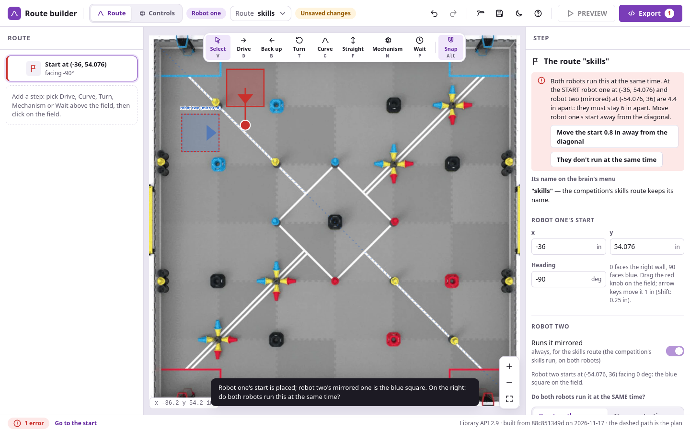

### 3. Add a drive

Pick **Drive** in the toolbar (or press **D**) and click where the robot should drive to. A dashed line shows the
plan, and a ghost square shows where the robot ends, facing along the line. A new step goes right AFTER the step
selected in the list (with none selected, at the end).

**"Turn to face it first"** is on: robot one's file declares it a tank, and a tank only steers itself back onto its
line when it starts within 15° of it. A drive that starts off its line **can** stop short of the point — on the host
test plant, 24 in legs up to 8° off their line arrived, but one 10° off already stopped short. So the step turns to
face the point, then drives. You can switch it off in the step's options on the right; the page marks the drive
amber (it may stop short) or red (more than 15° off: the library will not steer it back), and offers to switch it
back on:

A drive's speed, time limit and "how close" (on the right, under **Speed, time limit and how close**) are the
**drive's**: the turn to face the point first uses the robot's own settings.

The numbers on the field are the step numbers, at the spot where each step ends. Steps that end at the same spot
share one: **3–5** is the curve's end, where the claw opens and the robot waits.

**The green cross is your claw — put it on the pin**, not the square's edge: drag the cross itself (or switch on
**Place by the claw** on the right and type its x and y), and the robot's centre follows behind it. The switch stays on
for every drive until you switch it off; while it is on, the line under it shows the robot's centre. Backing up, the
robot drives over the spot before its claw gets there: to grab a pin, drive forward.

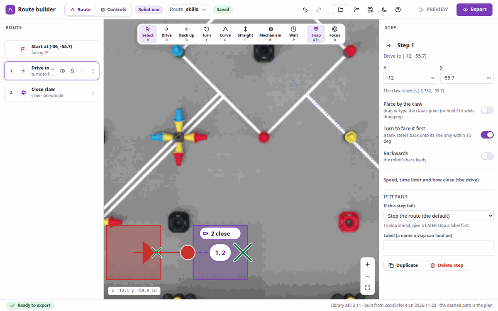

**Small moves.** **Straight** (**F**) drives forward a number of inches from where the robot is — type it; switch
**Backwards** on to back up instead. The code is the point it reaches (`r.driveTo(…)` or `r.reverseTo(…)`), so it
follows when you move a step before it. To place a point exactly, type its **x** and **y** on the right, or select it
(a curve's point: click or drag it on the field) and press the **arrow keys**: 1 in a press, **Shift** for 0.25 in.
Zoom in (**+**) and two points 1 in apart are two handles.

#### Solid structures on the field

The nine goals and the four Loaders stand on the floor, and the robot cannot drive through them. Each is drawn on
the field as a quiet outline, from the game manual's drawings (hover one for its name). Every step's path — the
robot's whole 15 in square, its turns and curves included — is checked against them:

- **Red:** the square goes into one on the way, or more than 0.5 in into one where the step ends. Select the step: it
  says where, which one and how far in, and that structure turns red with the robot's square at that moment. A drive
  or a back-up to a point offers **Go around: add a point at (x, y)** when there is a clear way round: one click adds
  a step to that point first, and both legs turn to face their point.
- **Amber:** the robot passes closer than 1 in, so a little drift and it clips it. A step that is meant to touch one
  — its front against a goal to place a cone, or against a Loader to take a load — switches on **Touches the … on
  purpose** on the right. That silences the amber for that structure. A red or blue goal narrows above its low base,
  so with the switch on, a step may end with the robot's front up to 1 in over that base. A red on the way stays
  red.
- A mirrored route checks robot two's path too, and the switch carries over: robot two touches the mirror-image
  goal. The Loaders are only on the red and blue walls, so robot two can meet one that robot one never does.
- In PREVIEW, a robot that drives more than 1 in into one went **THROUGH** it, as with a wall: its step red, the path
  faded after.

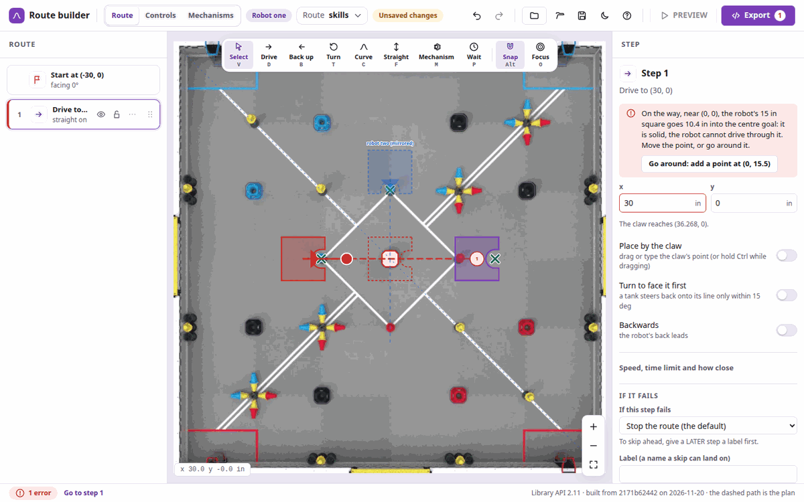

### 4. Add a curve

Pick **Curve** (**C**) and click the points the robot should pass through — up to 16 — then press **Enter** or
double-click. The dashed curve is the library's **own** curve (the same maths the robot follows), not a drawing of
it. Drag any point to change it. A point can have a heading — the way the robot's **nose** points there — or none,
and the library picks the smooth way.

A curve the library would refuse is red, with the point it refuses named, in plain words and in the library's own
sentence — here the path into point 1 doubles back on itself:

### 5. Work a mechanism

Press **Mechanism** (**M**). The menu shows robot one's mechanisms, one row each.

Click one, and what it does replaces the list, each a large button: the claw's **Close claw** and **Open claw**, a
toggle's **Run it**, the cascade's **Move the cascade** and **Find the bottom**. **‹ Back** or **Esc** goes back to the list;
**Esc** again closes it. **Up**, **Down** and **Enter** work too. The new step goes after the selected one.

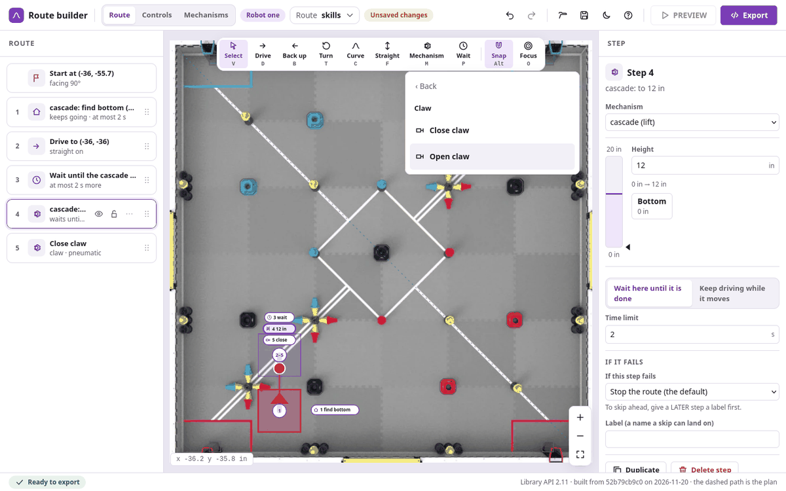

**Where the cascade goes.** A cascade move has one control: its travel drawn as a bar, 0 in at the bottom, 20 in at
the top. Click the bar, click **Bottom**, or type the **Height**. The arrow beside the bar is where the cascade is
before this step; the shaded part is where it goes; the line under the height says it: *0 in → 12 in*. An arm works
the same way, in degrees.

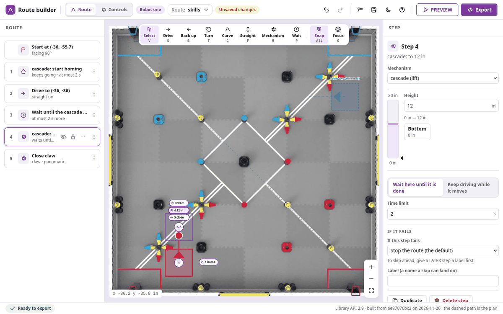

Once the cascade has levels (recorded at **Bench Tests station 13**), each is a mark on the bar and a button beside
it: click either to pick the level. A level not measured yet has no mark; its button says **not measured yet**, with
no number. The code moves a lift to a height, not by an amount (`cascade.to(12_in)`), and names a level by its number
in robot one's facts, so renaming a level never breaks the route. A project made before, with a "go up 6 in" step,
opens as it was: the step says *up 6 in → 18 in*, its own box edits it, and **Make it a height** turns it into "to 18
in" — the same C++ line; only its comment now says *to 18 in*.

**Wait here, or keep driving.** A move, a find-the-bottom or a run has two choices: **Wait here until it is done**, or **Keep
driving while it moves**. Keeping on, the step says where the route waits for it: at a later **Wait for it** step (the
menu offers it once a step before starts that mechanism). If a later step uses the mechanism again first, **Wait for it
before step N** is one click away. If nothing waits, the library stops it when the route ends: **Wait for it at the
end** is one click away.

**Its time limit** is the most the step may take. The page never makes one up: type it, or run PREVIEW and use the
time PREVIEW measured (step 6).

**Find the bottom first.** The cascade only knows its height once it has **found the bottom** — pushed gently down
until it stalls on its stop (the help, **?**, says why). A move before that stops the whole route (`NOT_HOMED`), so
the first height move in a route that never finds the bottom is red, with ONE card above its details: **Find the bottom
at the start**. One click adds it at the start (it runs while the first leg drives) and a **Wait for it** before the
move.

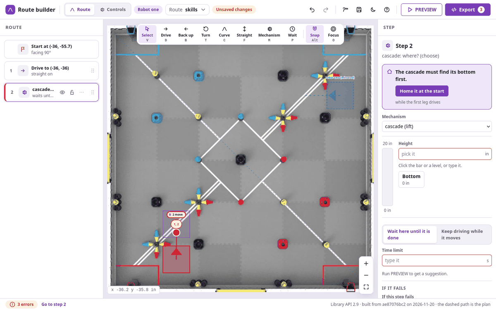

**On the field**, each mechanism step is a badge where the robot is when it starts: its number, its icon and one word
(*5 close*, *4 12 in*). Click a badge to select its step. At the start, the badges sit beside the robot, so the robot
and its heading knob still drag. A step that keeps driving draws a light band along the path
to the step that waits for it. Hide, lock and focus (step 10) work on the badges too.

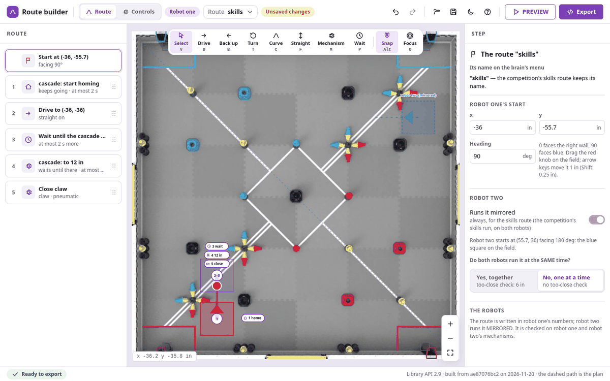

**After a drop, Leave gently:** a **Back up** added right after the claw opens (or a **Straight** step switched to
**Backwards** there) starts with **Leave gently** on: the robot waits ½ s, then backs out at 5 in/s. Both numbers are
under the switch; one click turns it off. A Back up clicked with **B** usually turns first, at the robot's own speed:
for a straight back-out off the piece, use **Straight** with **Backwards** on, as here.

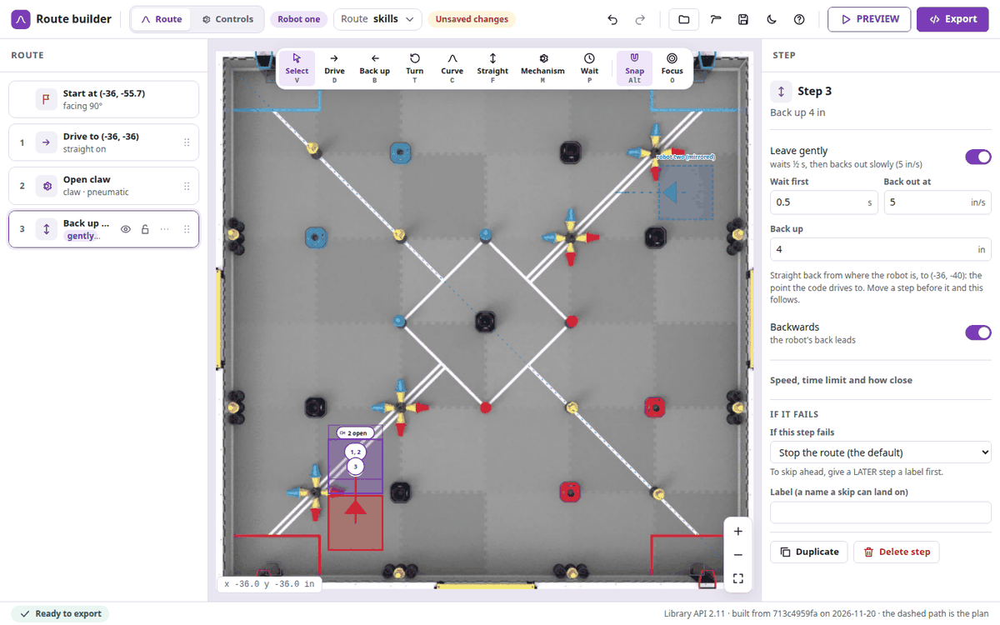

### 6. PREVIEW: watch the library drive it

Press **PREVIEW** (top right, or **Ctrl+Enter**). In about a second the robot drives your route on the field. It is
not a drawing: the page runs the **real library** — the same code the robot runs — on the **host test plant**, the
library's own model of a drive, and plays back what it did. The path the robot drove is solid; your plan stays
dashed beside it, so you see where the robot went differently from the plan.

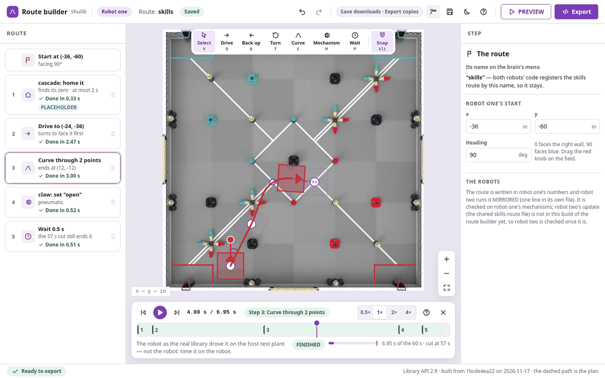

**The timeline** across the bottom shows each step's span in the colour of how it went: green done, red failed,
amber cut by the 57 s mark, grey skipped; a step too short to see at this scale is a thin mark at its moment. Play and pause with **Space**, go to the step before or after with
**Left** and **Right** (with **Shift**, 0.1 s at a time), to the start or the end with **Home** and **End**, and
choose the speed (½×, 1×, 2×, 4×). Drag along the timeline, or click a step in the list to go to where it began.
The small bar on the right is the run against the 60 s, the 57 s cut marked.

**The mechanisms** move beside the field, in step with the robot: the cascade's height on a bar (its bottom and top
marked, and while its step plays, the height it is going to), each piston's position (the claw open or closed), and
each toggle's motor, lit while it runs, with its direction. The mechanism the playing step uses is highlighted.
A step that only starts a mechanism ("keeps going") is not highlighted while the robot drives on, but its bar still
moves. Like the drive, their heights and times come from the host test plant.

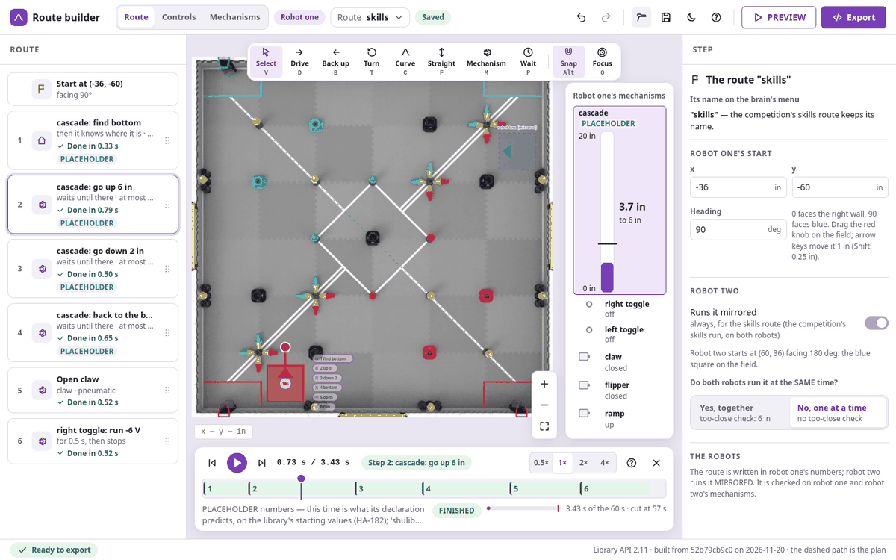

**The steps** on the left say how each one went, and the one playing is highlighted. A step that failed is red,
with the library's own line under it — the line the brain's log would show. A step in which the robot would go
**through a wall**, a goal or a Loader is red too, saying where (the host test plant has none of them in its way, so
the page checks the robot's square against the real field); the steps after it are grey, and the robot is drawn
faded from that moment: on the field it would not get there.

**Robot two.** PREVIEW plays robot one; robot two's mirrored run is not in it yet, and **About this run** says
so. Whether the two robots stay apart is checked while you build (step 2), for a route both run at the same time
([chapter 17](17-the-competition-program.md#both-robots-at-once)). PREVIEW does not wait for that answer, nor for a
too-close start or step: robot one runs the route the same either way.

**What the host test plant is not.** It is a stand-in drive — a 12 in tank with made-up gains, not your robot's —
with no walls, and every number robot one's facts file has not measured yet is a **PLACEHOLDER**: the steps that
used one say so, and **About this run** (the **?** button beside the speeds) lists them, with every line the library
printed. A mechanism still on the library's starting gains is marked **PLACEHOLDER** beside the field too (point at
the mark for why; **shulib Tune** sets the real ones on the robot,
[chapter 18](18-mechanisms.md#the-tune-program--tuning-on-the-brain-screen)). The steps, their order and what the
library refuses are the library's; the times and the exact path are the host test plant's. Time the route on the
robot with **shulib Auton Tester** ([chapter 16](16-testing-an-auton-on-the-bench.md)).

PREVIEW runs the route on the page, saved or not. Change the route and the run is put away (an undo brings it
back); press PREVIEW again. A route with a red step is not run — fix it first (robot two's red waits only for Export,
and an empty time limit on a mechanism step waits too: PREVIEW times it). **Cancel** stops a PREVIEW that is
running; one that takes longer than 20 s is stopped, and the page says so.

**A time limit from PREVIEW.** After a PREVIEW, select a step that has a time limit: under it, how long the library
took there and one click to use it — *PREVIEW took 0.78 s here on the host test plant, + 0.5 s. **Use 1.3 s***. The
page writes it only when you click. A mechanism step whose limit is still empty runs in PREVIEW with no limit of its
own (the 57 s cut still ends it), so the first PREVIEW times it; Export still asks for the number. A drive's suggestion
is above its **Speed, time limit and how close** (its limit may stay empty: the robot's own). It is the stand-in
drive's time, not your robot's, and the line says so: time the drive on the robot too. A step its time limit stopped
gets no suggestion: give it a longer limit and PREVIEW again. A step PREVIEW did not finish (skipped, or stopped when
the route ended), or could not time on its own (two steps starting one mechanism at once), says why, with no number.
A **Wait for it**'s number is how long the route waited there: after a drive, that depends on the stand-in drive too,
and its line says so. On the library's starting gains the line says **PLACEHOLDER numbers**: time the route on the
robot too.

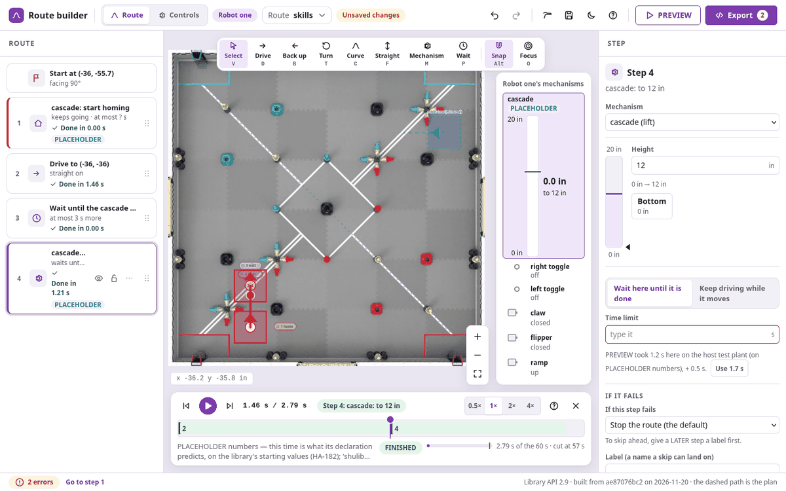

### 7. Send it to the robot

When the bottom bar says **Ready to export**, plug the robot's **brain** in with USB (not the controller) and press
**Send to robot one**. It writes your routes into `src/team/skills_route.cpp`, reads the file back, then builds and
uploads them. Each step shows as it happens (Export and Save wait until it ends):

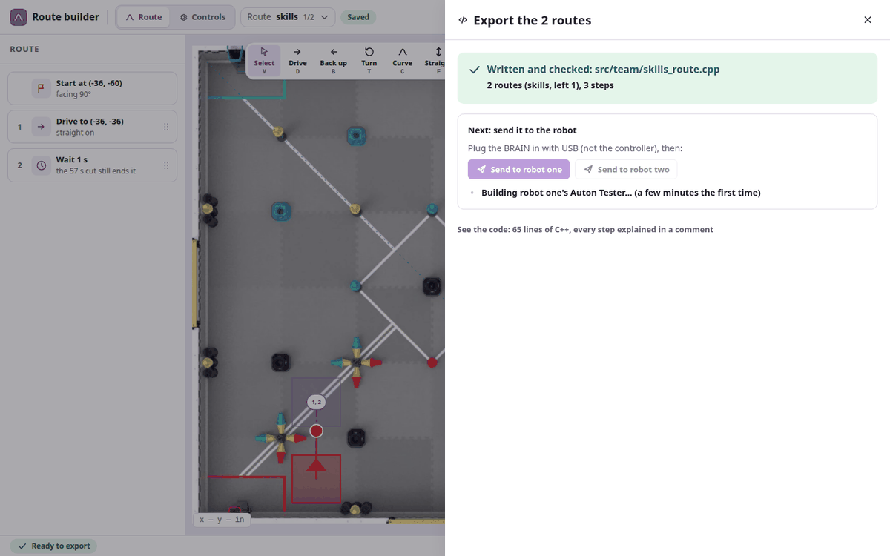

**✓ BUILT**, then **✓ UPLOADED** and where your route is on the brain:

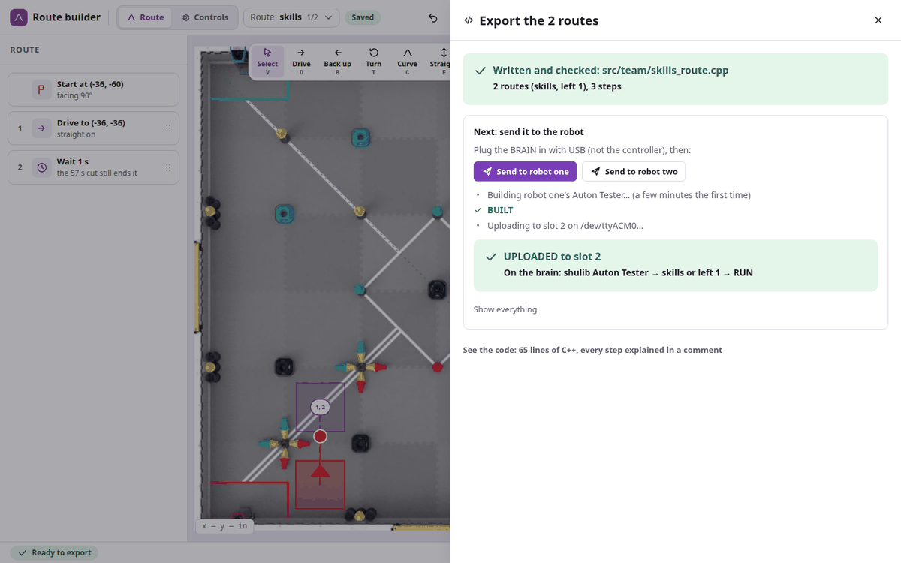

On the brain: **shulib Auton Tester** → your route → **RUN**.

When something is wrong it says so in red — **NOT BUILT** or **NOT UPLOADED** — and what to fix: a line of code with
its file and line number, "plug the BRAIN in with USB", or a robot fact still owed. **Show everything** has every line
make and pros printed. A robot whose autons file has lost the line that lists the routes is not sent to: the card names
the line, to tell the coordinator.

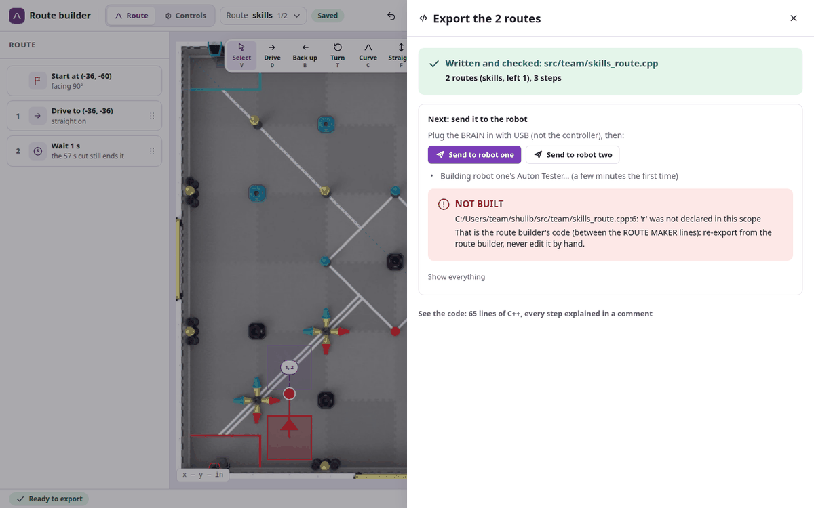

**Export** (**Ctrl+E**) is the same in two clicks — **Write into src/team/skills_route.cpp**, then **Send to robot
one** (or **two**) — with the code one click away. While a step is still red, a red number on Export counts what is
left, and Export (or Send) shows only that list — each with **Go there**.

#### Check the mechanisms, then watch the run

PREVIEW proves the order. Only the robot proves the claw is plumbed and the cascade reaches 18 in. Open the route's
menu (its name in the top bar); under **On the robot**:

**Check the mechanisms.** One screen says what will move. The robot stays where it is: clear the mechanisms' paths,
then **Send the check to robot one**.

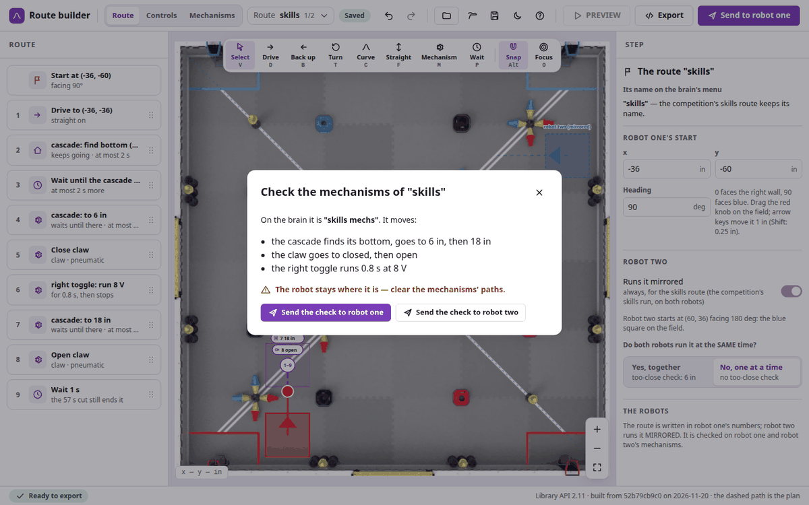

On the brain: **shulib Auton Tester** → **skills mechs** → **RUN**. Each mechanism step runs to its end, one after
another. When the upload ends, `src/team/skills_route.cpp` holds only your routes again, so a **shulib Competition**
built after it never lists the check. If the page says the file still holds it, Export before you build Competition.

**Watch the robot.** After a send that uploads, it opens by itself (or pick it in the same menu). Each step turns green
as the robot finishes it; a step that stopped is red, in the robot's own words; amber failed and carried on; grey was
skipped; a mechanism started while the robot drives says how it ended. One line sums it up, in the robot's own verdict's
colour, and the robot's END estimate (when it is LIVE) is the dashed square on the field.

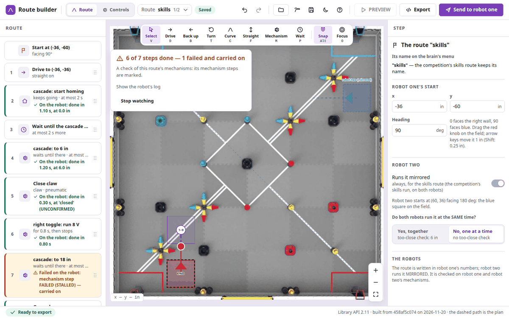

A program built before API 2.11 marks the steps when the run ends. Change the route after a run and its marks are
cleared. **Show the robot's log** has every line, and each watch is saved in `build/robot_runs/` for the coordinator.

**Camera.** Watching **shulib Drive** on a robot with an AI Vision sensor, the **Camera** tab beside **Run** draws what
the camera sees, ten times a second — each AprilTag with its number, each object with its score, each colour with its
number, said in one line above — and greys it when the camera stops reporting it. Open **Watch the robot** before you
start Drive: the camera's port and its model's object names are printed only as Drive starts. Without a name an object
shows its number, `class 0` (on 2026-11-20 the camera printed no names).

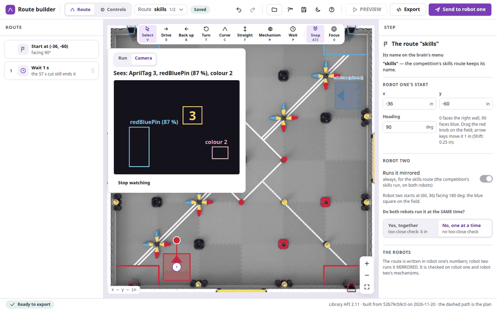

**What is on robot one.** Each slot against what should be there: the first wrong one is red, with its fix. It only
reads. (In VS Code: **Terminal → Run Task → What is on robot one**.)

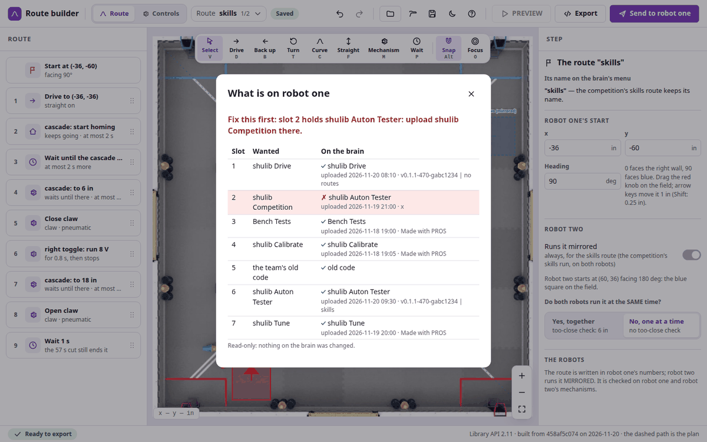

#### From the website

On the website's route builder, Export shows **one card: the step for your browser**, the step to do now highlighted.

- **Edge or Chrome:** **1** **Connect your shulib folder** (the one with `src` inside), once. **2** **Write into
  src/team/skills_route.cpp**: only the lines between its two `ROUTE MAKER` lines change, and the page **reads the
  file back**.
- **Firefox and others:** **1** **Pick skills_route.cpp and download the updated one**. **2** Replace
  `src/team/skills_route.cpp` with the newest download. **Then Save** (step 8), so the next export knows that code is
  the builder's.
- **Or Copy the code** and paste it over the two `ROUTE MAKER` lines and everything between them (a picture shows
  where). A file that has lost those lines gets no Copy: the page says how to put them back first.

The result is never silent: green (**Written and checked** with the routes and their steps, **Downloaded**,
**Copied**) or red, with **the fix**. Code changed by hand between the lines is replaced only if you choose
**Overwrite**. Then **Will it build?** (what the page checked; the C++ compiler checks the rest) and **Next**: the
build and upload commands for robot one or two, each with **Copy**, or one command for both
([chapter 16](16-testing-an-auton-on-the-bench.md)). The quickest: in VS Code, **Terminal → Run Task → Upload
routes to robot one** (or two) — it runs `python3 tools/upload_auton.py one` and ends with **✓ UPLOADED** or **✗** and
what to fix. On the brain: **shulib Auton Tester** (slot 6) → the route → **RUN**.

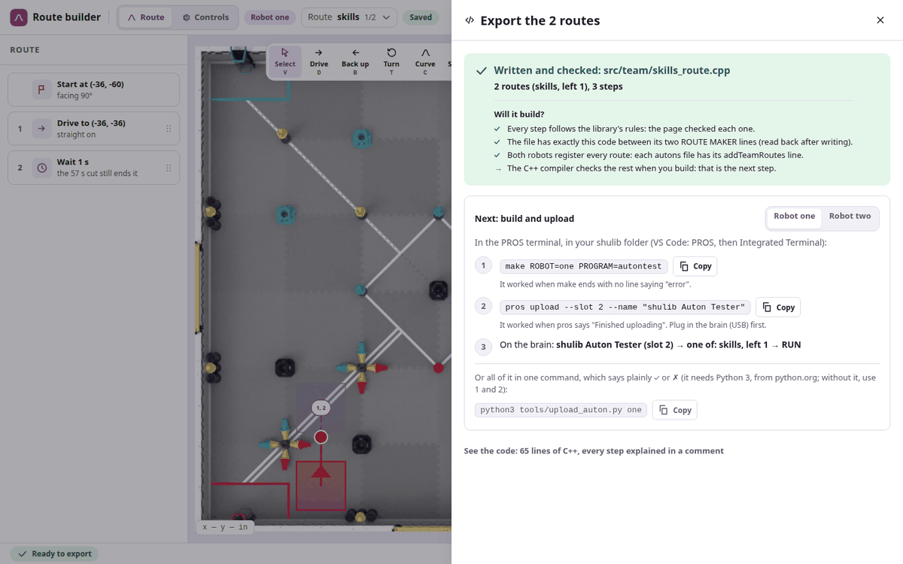

Next's first line says the easiest way: the route builder opened from VS Code, where all of this is **Send to robot**.

Export writes **every route** of the project (step 9) between the two `ROUTE MAKER` lines, and a red step on any of
them stops it — the list names the route, and **Go there** opens it. One line in each robot's autons file registers
them all: `addTeamRoutes(registry, TeamRobot::One);` in robot one's, `...::Two` in robot two's, which runs each route
marked mirrored **mirrored** across the field's diagonal. Opened from VS Code (or with the folder connected), the export page
checks both lines are there and says so. (A copy of the repository from before robot two's update, 2026-11-17, has
no `src/team/skills_route.cpp`: opened from VS Code, or in Edge or Chrome, the page says so and offers Copy.)

#### Reading the code

Everything between the two `ROUTE MAKER` lines is the route — **See the code**, under the card — and every step is a
comment, then its code. Step 2, for one:

- **The comment** says what the step does in plain words, with its numbers, and the page's step number first:
  *Step 2 — DRIVE to (0, -36) in: about 26.8 in. First it turns to face the point …*
- **The code** is the library's own calls (`r.` is the route being built), every number with its unit: `_in`
  inches, `_deg` degrees, `_s` seconds, `_volt` volts. A drive that turns first is two calls — `r.face(…)`, then
  `r.driveTo(…)`. A position is `claw["open"]`; a level, once the cascade has levels, `cascade[facts::lv(2).name]` —
  level 2 of robot one's facts.
- **The brain's numbers.** If the route stops on the robot, the brain's log says `STOPPED at step N` with the call's
  name. A drive that turns first is TWO calls, and **Leave gently** adds one for its wait, so the brain counts one
  step more than the page for each turn and each wait (two for a Back up that does both) — and wherever the two
  numbers differ, the comment says the brain's too (*"The brain's log calls the turn step 2 and the drive step 3."*).
- **Above the steps:** the `Routine` that runs them, named for the route. **Below them:** the route's entry — the name
  on the brain's menu, robot one's start, and the 60 s skills timing (stop at 57 s, everything off at 59 s). Each
  route has its own steps and entry; at the end, **one list** (`kTeamRoutes`) of every route in order, each with
  `Mirror::ForRobotTwo` or `Mirror::None` and `Together::Yes` or `Together::No` (the answer from step 2: the host
  suite checks the two robots stay apart only on `Yes`).

You should be able to explain every line; if one surprises you, ask before you run it.

Then **Send to robot** (or, on the website, the **Next** card above), and run the route in **shulib Auton Tester** on
the robot.

### 8. Save

**Save** (**Ctrl+S**) writes the project — your route, step by step — to `src/team/route_maker.json` (opened from
VS Code, or Edge or Chrome with the folder connected) or downloads it (put it in `src/team/`). **Open** reads it back. Commit it with
the code: it is how anyone carries on from where you stopped.

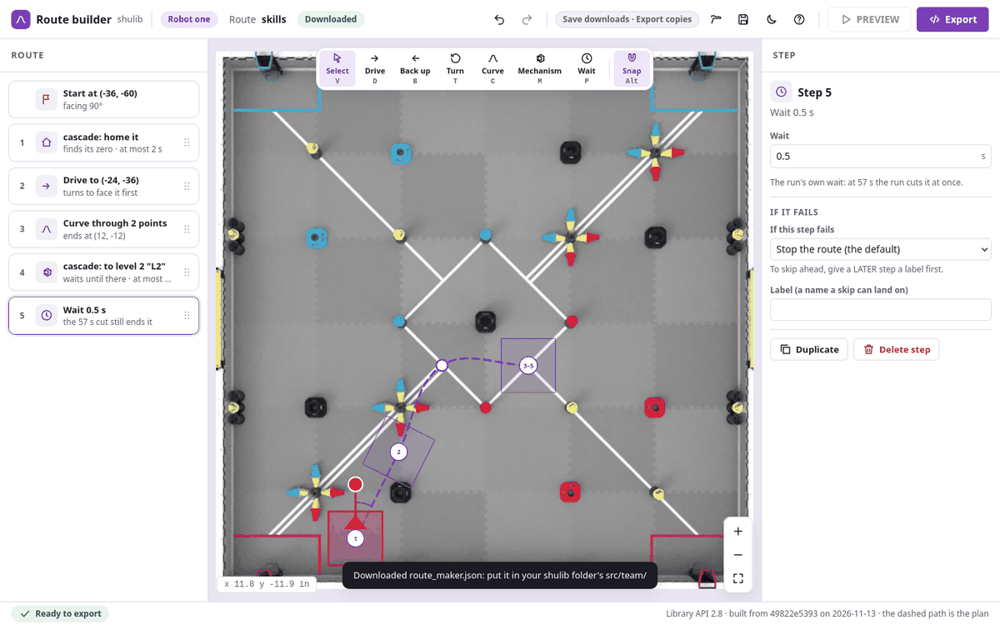

Until you save, the page keeps a draft in this browser, and says so when you come back (if it ever cannot show that
draft, it opens a new route and says so; your `route_maker.json` is not touched). Opened from VS Code (or with the
folder connected),
it compares itself with the folder's `route_maker.json` — after a `git pull` brought a teammate's route, it asks
which to keep — and **Save** never replaces a `route_maker.json` that changed in the folder without asking.

### 9. More routes

The button in the top bar (**Route skills ⌄**) holds the project's routes: the skills route, a test route, a
practice route, each picked **by its name** on the brain's **Auton Tester** menu. Click it to switch routes (one is
on the field at a time), and for **New route**, **Rename**, **Duplicate** and **Delete** (Delete asks first; **Ctrl+Z**
brings a route back).

A name is what the brain's menu shows: 1 to 29 plain characters (25 for a mirrored route, which robot two shows as
`<name> SKILLS MIR`), no `%`, `"` or `\`, not `NONE`, and no two routes named alike (capitals aside) — nor like
the menu's other two autons, `40in forward` and `TEST 24in turn back`. The box says why as you type, and **OK**
waits. The **skills** route — the competition's — keeps its name and is always there. The brain's menu holds 16
autons, and those two take 2: at most 14 routes.

### 10. Crowded spots: hide, lock, focus

A real route goes back to the same few spots, so its points sit on top of each other. Three ways to get the others
out of the way, each from the step's row in the list (hover or select it) or a key with the step selected:

| | What it does |
|---|---|
| **Focus** (**O**, or **Focus** above the field) | Only the selected step and the steps just before and after it are drawn full; the rest fade and cannot be clicked. Select another step and the focus moves with it. **Esc** or **O** shows everything again. |
| **Hide** (the eye, **H**) | The step is not drawn on the field and cannot be clicked there. It still runs, in PREVIEW and in the code. Its row is dimmed; **Show all** at the top of the list brings every hidden step back. Hiding, locking or folding while a PREVIEW shows puts the run away (**Ctrl+Z** brings it back). |
| **Lock** (the lock, **L**) | The step is drawn but cannot be dragged or moved with the arrow keys: a click on it goes to whatever is under it. Its numbers can still be typed on the right. |

Where points still overlap, click the spot again to pick the next point under it; the right side says **2 of 3
here**. A drag there moves the highlighted one, and hovering names the step a drag would move (the highlighted one
when it is there, else the top one).

**Sections.** A step's **...** menu has **Start a section here**: a name ("Start", "Claw 1") for the steps from it to
the next section. The section's row in the list folds them away, and hides or locks them all in one click. A step
moved into a folded section opens it, so you always see where the step went.

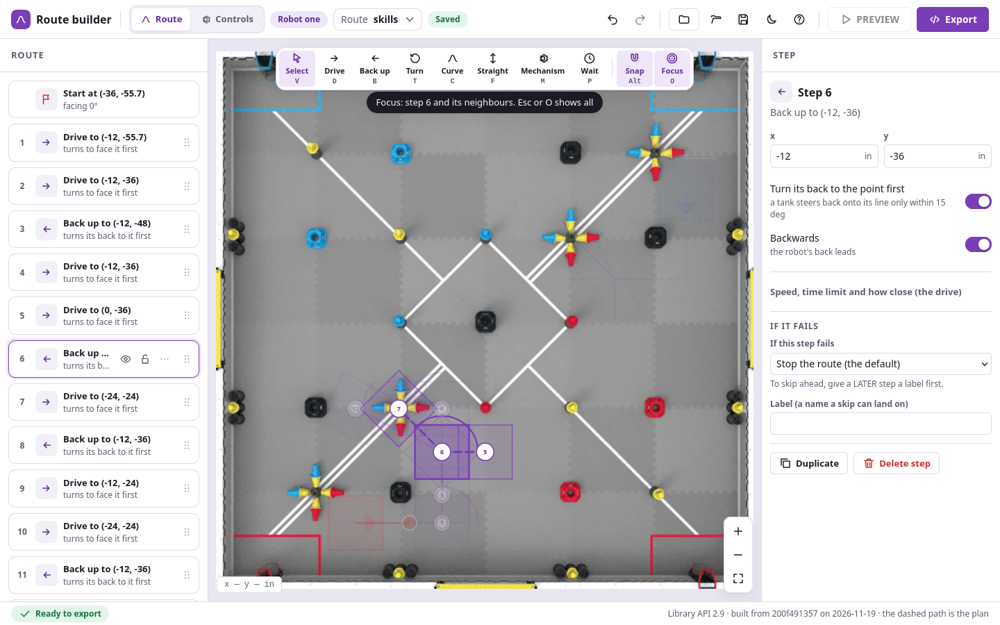

Hide, lock and sections are saved in the project file and undone with **Ctrl+Z**; focus is only for now. None of
them changes the exported code. An offline copy of the route builder downloaded before this feature cannot open a
project that uses them: download it again.

## The driver's buttons and the driving feel

**Quick start — the Controls tab in 5 steps**

1. Click **Controls** in the top bar: **1 · Buttons** shows robot one's controller.
2. Click a button; a free (dashed) one: pick its mechanism, then its job.
3. **2 · Driving feel**: set the dead zone and the curve.
4. **Export** (**Ctrl+E**) → **Write into src/team/robot_one_driver.hpp**.
5. Put it on the robot: VS Code **Terminal → Run Task → Upload a program to a robot** → **Robot one** → **Drive**,
   then again with **Competition** (both run the driver file). Robot two: pick **two** in steps 1–5.

<video controls preload="metadata" poster="../../assets/video/controls-tab.jpg" src="../../assets/video/controls-tab.mp4" style="max-width:100%"></video>

Music: "Wallpaper" by Kevin MacLeod ([incompetech.com](https://incompetech.com)), licensed under [Creative Commons: By Attribution 4.0](https://creativecommons.org/licenses/by/4.0/). Voice: Kokoro.

The **Controls** tab (top bar, beside **Route**) sets what each button does in driver control and how the sticks
feel, in two steps — **1 · Buttons** and **2 · Driving feel** — one on the screen at a time. It edits robot one's
driver file, `src/team/robot_one_driver.hpp` (or robot two's — pick **one** or **two** at the right of the steps). It
opens with the driver file as it was when this page was published (with nothing clicked, the panel beside the
controller gives the date); opened from VS Code (or with your shulib folder connected) it reads today's file. Once you change a robot's
controls, your project file keeps them, and the tab opens with those. It changes only what you change. Connecting
the folder or opening a project keeps a change made here: when this page had no route yet and the folder's project
has no controls for that robot, your change stays; otherwise **Ctrl+Z** on this tab brings it back. The one
exception is a project whose controls for that robot this page cannot read (a newer route builder's): the tab then
shows the driver file, read only, and your change there is gone. The page says which.

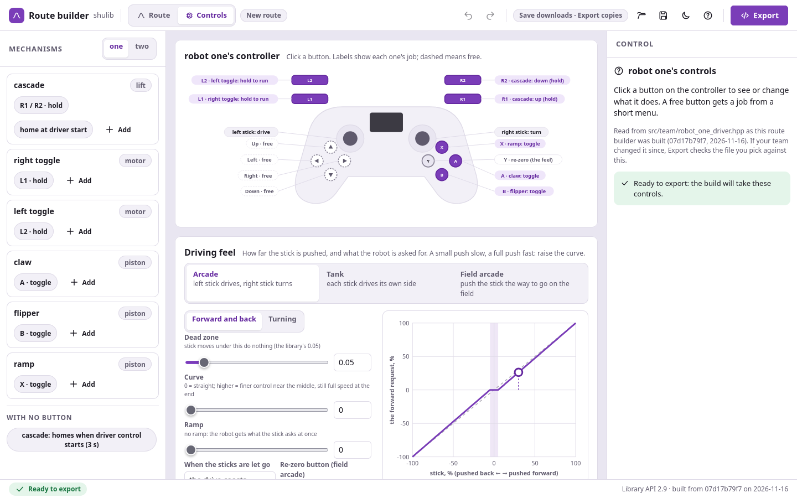

### Step 1 · Buttons

The picture is the V5 controller. Each button's label says its job; a **dashed** button is free, and Y is the
drive's re-zero button. Click a button (or its label) and the panel beside the controller (under it, in a narrow
window) shows that one job — its button (both, for a pair) is the only one highlighted on the controller (a button
with a problem stays red). **Esc** or **×** closes it. With nothing clicked, the panel lists your mechanisms and their
buttons, and says in a sentence any job that needs no button ("The cascade finds its bottom by itself when driver
control starts").

- **Give a free button a job:** click it, pick the mechanism, then pick the job. Each job says exactly what it picks
  (**Move while held: Up up, Down down**; **Go to "open" on one press**). Then finish it in the panel — the volts of a
  hold (12 is full power), the level and its time limit, or the second button of a pair when its partner is taken.
- **Change a job:** click the button. The panel shows the mechanism, what it does, its button, its volts or time
  limit, and **Make X free** (both buttons of a pair: **Make R1 and R2 free**).
- **A job with no button:** click the mechanism in the panel's list — "find the bottom when driver control starts",
  or "autons only".
- **The words:** the comment on its line and its row in the button map at the top of the file are yours to
  reword (in the panel, under **Its words in the file**). Change what a control does and both become the page's words
  again (**Ctrl+Z** brings yours back); move it to another button and yours are kept.

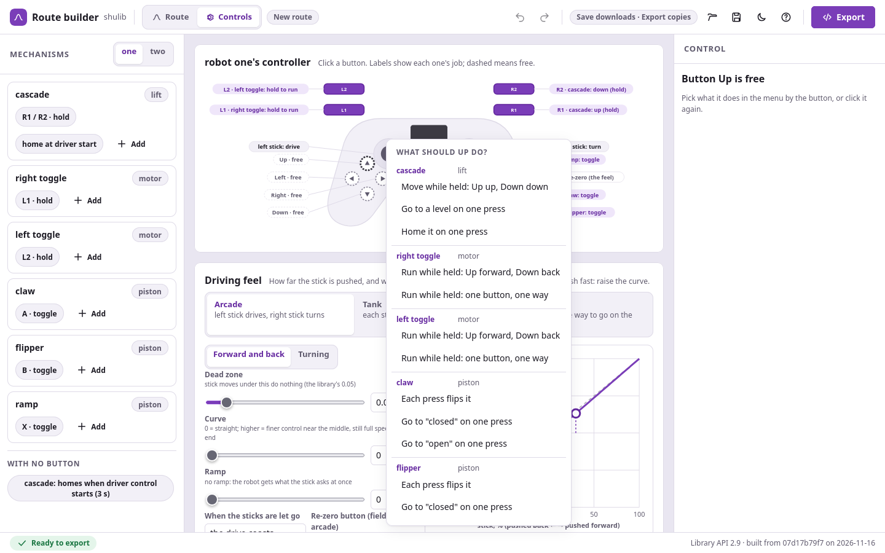

| Mechanism | What a button can do |
|---|---|
| a motor (robot one's side toggles) | run while held — one button forward and one back, or one button, one way |
| an arm or a lift (the cascade) | move while held (one button up, one down); go to a level on one press; find the bottom on one press; find the bottom when driver control starts (no button) |
| a piston (the claw, the flipper, the ramp) | each press flips it; go to one position on one press |
| a flywheel | each press spins it up to a named speed or stops it; spin up to a speed on one press |
| any | autons only: no button in driver control |

**What the page refuses** — what the build refuses, in plain words, with the build's own name beside them:
a button doing two jobs (`button_B_does_two_jobs`), a hold's volts not above 0 or above 12, a level or a
find-the-bottom with no time limit, a level the mechanism does not have, a mechanism with no button (choose "autons
only" if that is meant), a control on the re-zero button, more than 24 controls, and an arm or lift that must find the
bottom with no way to do it in driver control. It also asks for what is not finished yet — a button, a level, or the second button
of a pair it does not choose for you. Export lists them, each with **Go there**. The button map at the top of the
file is written from the same choices: each control's rows sit where its buttons are, in the code's order. Its
words are yours. Give a free button a job and a map line calling it free (the d-pad FREE line, once Up has a job)
goes in the same click — the page says so, and one **Ctrl+Z** brings both back. The page stops on words it can tell
are wrong now — a line like that already in the file (**Remove that line**), or words naming a button whose job
changed after they were written — the file's or yours (**Use the page's words** replaces only that comment or row) —
and asks you to check a note in the file that speaks of a mechanism or button you changed. Words it cannot judge are
yours to keep true.

### Step 2 · Driving feel

"Move the stick a little and the robot goes slowly, but still moves; push it all the way and it goes fast" — that
is the **curve**. Click **2 · Driving feel** (or a stick on the controller). First, the essentials:

- **The style** — **Arcade** (the left stick drives, the right stick turns), **Tank** (each stick drives its
  own side) or **Field arcade** (push the stick the way to go on the field, whichever way the robot faces).
- **Dead zone** — a stick moved less than this does nothing (the library's default is 0.05).
- **Curve** — 0 is straight: half a push asks for half speed. Higher gives finer control near the middle and still
  full speed at the end.

The rest waits under **More settings** (closed at first):

- **Which stick direction** the dead zone and curve shape — **Forward and back**, **Turning** (and **Sideways** on a
  robot that can strafe). The heading above them says which.
- **Ramp** — how quickly the request may change: at 4 per second, "full speed from rest in 0.25 s" — and a stop from
  full speed takes as long, so with a ramp the robot does not stop the instant the sticks are let go. 0 is no ramp.
- **When the sticks are let go** — the drive coasts, brakes or holds; **the re-zero button**; and **Use the library's
  defaults**.

The graph is the library's own formula — the same numbers as the library's C++, checked on the host at 9 630 points:
how far the stick is pushed along the bottom, what the library asks the drive for up the side. Drag the dot to try
a push: "30 % stick → 12 % speed". It is the REQUEST, not a measured speed. In **Tank** both sticks are first
averaged into a forward request, (left + right) / 2, and a turn request, (right − left) / 2; the curve shapes those.
A dead zone of 1 or more, or a curve outside 0 to 1, is refused by the page and by the build (`the feel is out of
range`). When "shulib Drive" starts, it prints the feel it runs (its `driver feel:` line, made from the driver file).

### Export the controls

**Export** (**Ctrl+E**) on the Controls tab shows the three parts of the driver file it writes, each with **Copy**:
which button does what (`kControls`), the button map at the top of the file, and the feel (`kFeel`, and the re-zero
button and what the drive does when let go). Opened from VS Code (or with the shulib folder connected), **Write into
src/team/robot_one_driver.hpp** changes only the lines between the file's three pairs of marker lines —
`// [driver file one]`, `// [control words one]` and `// [feel one]`, each with its `[/…]` partner — and keeps the
file's own line endings. A part someone changed by hand since the last export is not replaced unless you choose
**Overwrite**. In Firefox or Safari, **Pick robot_one_driver.hpp** gives the updated file back as a download, with
the same check. A driver file without the `control words` and `feel` markers (a copy from before robot two's
update) can only be copied. **Undo** and **Redo** (**Ctrl+Z**, **Ctrl+Shift+Z**) work on this tab too, on the
robot shown.

Then put it on the robot. The driver file runs in **shulib Drive** (slot 1) and in **shulib Competition**'s driver
control (slot 2), so upload both: VS Code **Terminal → Run Task → Upload a program to a robot**, pick the robot,
then **Drive**; run it again for **Competition**. Without VS Code: `python3 tools/upload_auton.py one drive`, then
`python3 tools/upload_auton.py one competition` (`two` for robot two; `python` on Windows). Each says **✓ UPLOADED**
or **✗** with the first real error; the build is the final judge of every line.

## The mechanisms on the robot

The **Mechanisms** tab (top bar, beside **Controls**) shows every mechanism on robot one (or **robot two**), one card
each: what it is, its ports (and which way each motor turns), its buttons, its levels, and the routes that use it —
click a route to open it at its first step on that mechanism. A fact the builders have not sent yet says so ("not known
yet"), never a guess.

**Test** moves that one mechanism on the robot while the robot stays where it is: the cascade finds the bottom, goes to
each level (with none yet, the middle of its travel), then back to the bottom; a motor runs one way, then the other; a
piston goes to each position, then back to where it starts. The screen of **Check the mechanisms** (step 7) says what
will move first; **Send the test to robot one**, then on the brain **shulib Auton Tester** → **cascade mechs** →
**RUN**. The card turns green, with the time, when the robot says every step worked (amber: done, but not as asked;
red: in the robot's own words). **Test every mechanism** does them all in one run (**all mechs**). Like the check, the
test is only on the brain. Testing needs the route builder opened from VS Code. While a fact the robot's **Auton
Tester** needs is still owed (robot two's, until station 13's quick pass), the tab says so at the top and Test sends
nothing: that program would not build.

**Find the bottom.** The motors count turns from wherever they were at power-up, so the robot does not know the
cascade's height until it pushes gently down onto its bottom stop and calls that 0 in. The page calls this **find the
bottom**; the code calls it `home()`.

## The reference

### The steps

| Step | Toolbar | What it does | The C++ it writes |
|---|---|---|---|
| Start | click the empty field | where robot one is placed, and its heading | `e.start = competition::StartPose::field(x, y, h)` |
| Drive | **D**, click | drives to a point, arriving facing along the line; on a tank it turns to face the point first | `r.face(x, y);` `r.driveTo(x, y);` |
| Straight | **F**, type the inches | drives forward (or, **Backwards** on, backs up) that far from where the robot is; backing up, it has **Leave gently** too | `r.driveTo(x, y);` / `r.reverseTo(x, y);` — the point it reaches |
| Back up | **B**, click | the same, backwards (its back turned to the point first); **Leave gently** first waits, then (after the turn) backs out slowly | `r.faceAway(x, y);` `r.reverseTo(x, y);` — with Leave gently, the Wait first and `{.maxLinearSpeed = 5_in / 1_s}` on the back-up |
| Turn | **T**, click | turns in place to face a point, its back to a point, or to a heading | `r.face(x, y)` / `r.faceAway(x, y)` / `r.turnTo(h)` |
| Curve | **C**, click 1–16 points, Enter | one smooth path through the points (forwards or backwards) | `r.curveTo({...})` / `r.reverseCurveTo({...})` |
| Mechanism | **M** → the mechanism → what it does | a lift to a height in inches, or to its bottom (an arm in degrees), or to a level — one control, the bar; a pneumatic's position (its own button); a motor for a time; find the bottom. A move, a find-the-bottom or a run waits until it is done, or keeps driving | `r.move(cascade.to(18_in), t)`, `r.move(arm.to(90), t)`, `r.startMove(...)`, `r.set(claw["open"])`, `r.run(...)`, `r.home(...)` |
| Wait for it | **M** → the mechanism → **Wait for it** | waits for the mechanism's last step (offered once a step before starts it) | `r.waitUntilDone(m, t)` |
| Wait | **P** | a pause in seconds — the run's own wait, so the 57 s cut still ends it | `r.then([&] { return ctx.guard.pause(t) ... })` |

Every step also has **If it fails** — stop the route (the default), carry on, or skip ahead to a step you gave a
**label** — and, on a drive or a turn, its time limit, top speed, turn speed and how close it must arrive (empty
means the robot's own; on a drive that turns first, they are the drive's). A number box takes plain digits — `2.5`,
not `2.5s`: anything else is marked and not kept.

A height is written as the library's constant target — `cascade.to(18_in)`, an arm's `arm.to(90)` (a plain number:
the library refuses `_deg` there) — from the height the page tracked; the step's own words ("UP 6 in, to 18 in") are
in its comment. A level of the cascade is written through the robot's facts — `cascade[facts::lv(2).name]` — so
renaming a level in the facts file never breaks a route; the cascade has no levels yet (they are recorded at Bench
Tests station 13), and a move to a level in a project file from before is red, with the same words.

Not yet in the route builder (they come in its next updates; until then they are typed by hand inside the region,
and the page never overwrites a hand edit): triggers partway through a drive, wall resets, the time bar, and the
Toggle steps.

### The checks

A **red** step is one the robot would refuse — the library would not build it, or would stop the route on it. Until
every red step is fixed, Export shows only the list of them (each with **Go there**), and the bottom bar goes to the
first one. An **amber** step is a warning: it runs, but probably not as you mean. Each check says what is wrong in
plain words — with the library's own sentence underneath where the library has one — and where there is a
one-click fix it offers it.

| The check | Red when |
|---|---|
| Inside the field | the robot's 15 in square would go more than 1 in into a wall — at a point, turning in place, or anywhere along a curve |
| Solid structures | the square goes into a goal or a Loader on the way, or more than 0.5 in into one at the start or where a step ends (a red or blue goal: 1 in, when the step touches it on purpose); robot two's mirrored path too. Amber when it passes closer than 1 in, unless the step touches it on purpose |
| The start | there is no start, a number of it is missing (a `route_maker.json` edited by hand: the list shows `?` for it, and the robot is drawn once you type it), or it is through a wall |
| Turn first (tank) | a drive is not turned first and starts more than 15° off its line (amber from 0.5°) |
| The curve | the library refuses it: its first point is behind the robot, two points are closer than 1 in, a point doubles back (amber: a bend tighter than the robot can follow) |
| Find the bottom first | a cascade (or any arm or lift that finds its bottom by a stall or a switch) is moved before it has FINISHED finding the bottom on every way the route can go (the first such move of a route that never does shows one card for it: **Find the bottom at the start**) |
| Wait for it | nothing before it starts that mechanism, or a skip can pass over the step that does |
| Levels and positions | the mechanism, the level or the position is not on the robot (or the mechanism has no levels yet) |
| Heights | no height yet; a "go up" or "go down" (a project made before) where the page cannot know the height (nothing found its bottom or moved it to a height before: **Find the bottom first**, or pick a height on the bar); or a height past the travel (one click: only as far as the top, or back to the bottom) |
| Both robots together? | a mirrored route has no answer yet (**Yes, at the same time** / **No, one at a time**, one click) |
| Too close | answered **Yes**: the two robots' squares come closer than 6 in at the start or on a step — the step, the moment and both places said, both squares outlined |
| Time limits | a time limit is empty or not above 0; volts outside -12 to 12 |
| Leave gently | its wait not above 0 or past 2 s, or its speed outside 2 to 20 in/s; a back-up too long to finish at that speed inside its time limit (the robot's own is 5 s) |
| Labels and skips | two steps with one label, or a skip to a label that is not on a LATER step |
| The name | a name the brain's menu cannot show, one with `"` or `\` or a space at an end, two routes named alike (capitals aside), more than 14 routes, or a project with no `skills` route (offers **Name it "skills"**) |
| A newer project file | opening a `route_maker.json` made by a newer route builder (a step, or a field of the route, this one cannot write): refused by name, nothing opened. A robot's Controls this one cannot read open read only instead (the Controls tab) |

### The keyboard

| Keys | |
|---|---|
| **V** or **Esc** | select (and cancel what is being added) |
| **D**, **B**, **T**, **C**, **F**, **M**, **P** | drive, back up, turn, curve, straight, mechanism, wait |
| in the **M** menu: **Up**, **Down**, **Enter**, **Esc** | walk it, pick; **Esc** goes back to the mechanisms, then closes |
| **Arrow keys** | move the selected point 1 in (**Shift**: 0.25 in) |
| **H**, **L**, **O** | hide, lock the selected step; focus on it and its neighbours (**Esc** leaves) |
| a click again on one spot | the next point under it |
| **Delete**, **Ctrl+D** | delete, duplicate the selected step |
| **Ctrl+Z**, **Ctrl+Shift+Z** | undo, redo |
| **Ctrl+S**, **Ctrl+E** | save, export |
| **Ctrl+Enter** | PREVIEW |
| **Space** (a tap), **Left**, **Right** | in the preview: play or pause, the step before or after (**Shift**: 0.1 s) |
| **Home**, **End**, **Esc** | in the preview: its start, its end; close it |
| **Alt+Up**, **Alt+Down** | move the selected step in the list |
| **+**, **-**, **0** | zoom in, out, fit the field |
| **Space** + drag | pan |
| **Alt** while placing or dragging | no snapping |
| **Ctrl** while dragging a drive's point | place it by the claw: the green cross goes where you point (not snapped) |
| **?** | the list in the page |

Points snap to the half-tile grid (every 12 in) and flush against a wall; headings snap to 15°.

### The project file

Save writes `src/team/route_maker.json`. It holds every route, in order, in the same units you see — inches,
degrees, seconds, volts — one step per entry, in a fixed order so a change shows as a small `git diff`, and for a
mirrored route the answer to "both robots at the same time?" (`together`), and the structures a step touches on
purpose (`touches`). It keeps how each step shows on the page too — hidden, locked, its section (`view`). The export
reads neither. It also remembers a fingerprint of the
code it last exported, so that if someone edits the code between the `ROUTE MAKER` lines by hand, the next export
asks before replacing their change (**Keep their change**, or **Overwrite**). **Deleting the two `ROUTE MAKER`
lines** makes the routes hand-written code that the route builder leaves alone from then on. A project file from
before named routes (one route, `skills`) opens as it is, and asks the step-2 question.

Once you change a robot's buttons or feel on the **Controls** tab, the project file also holds that robot's controls
and feel (under `robots`, with a fingerprint of each part of its driver file it read or wrote), and from then on
the tab shows the project's, exported or not.

