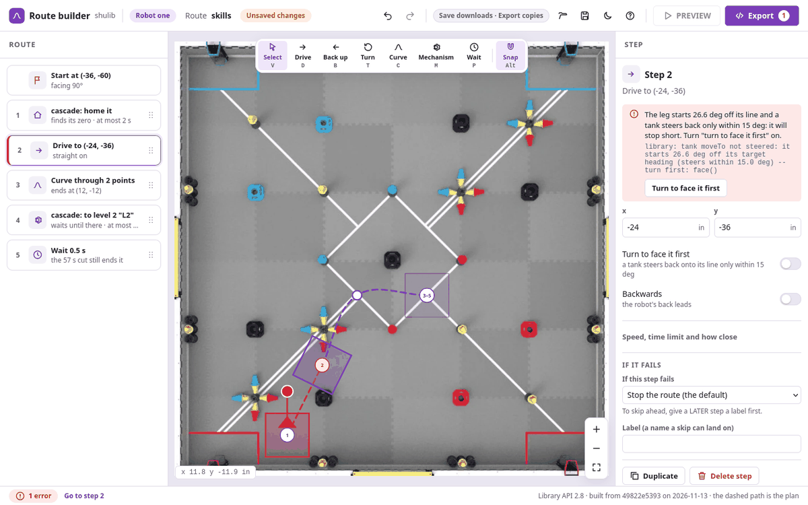
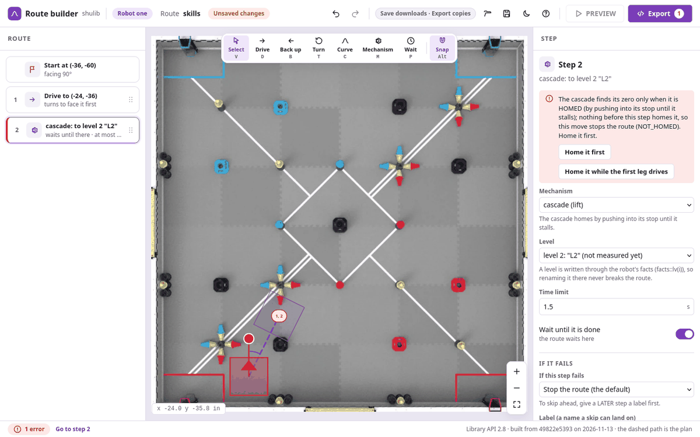
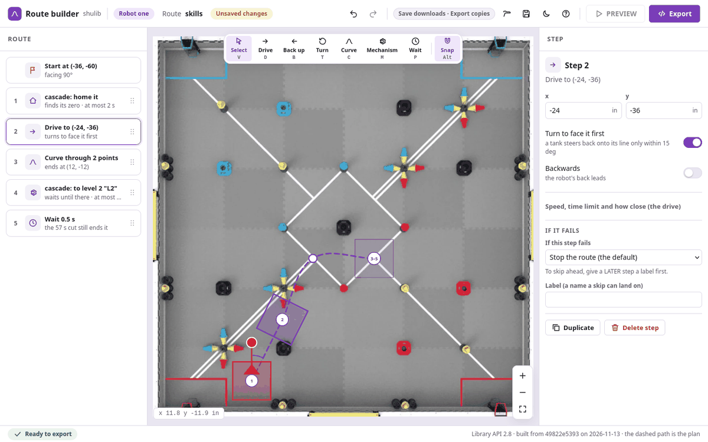

# 22 — Making your first route with the route builder

The **route builder** is a web page where you build the skills route by clicking on the real field, and get the
C++ for the robot out of it. You place robot one's start, add steps — drive here, curve through there, raise the
cascade — and the page checks every step against the library's own rules as you go. When the route is right, you
export it into the robot's code. Every line it writes is commented in plain words; it is your route, and you
should be able to explain every line of it.

This chapter is in two halves: [your first route](#your-first-route), step by step, and then
[the reference](#the-reference) — every kind of step, every check, the shortcuts, and the project file.

The route in the pictures is an example of **how to click**, not a route for the robot: where robot one starts and
where it goes are your team's to decide.

## Your first route

### 1. Open it

Open **docs.shurobotics.com** and click the **Route builder** tab, then **Open the route builder**. Use **Edge or
Chrome** if you can: they can write the route straight into the shulib folder. Firefox works too — it downloads the
project and copies the code instead (Safari should do the same, but no test runs it). For the event, click
**Download for offline use** beforehand: it saves one file you double-click with no internet.

The field is the real Override skills field, **red at the bottom** — you are looking at it from behind the red
alliance station, as in [chapter 2](02-the-field-and-coordinates.md). Every number is in **inches** from the field's
centre: **+x to the right, +y away from you (toward blue)**. Headings are in **degrees**: 0 faces the right wall,
90 faces blue, -90 faces red.

### 2. Place robot one's start

Click the field where robot one starts. Its 15 in square appears in red, its **front** marked with a triangle. Drag
the square to move it; drag the **red knob** in front of it to turn it (it snaps to 15°; hold **Shift** for 1°). The
numbers are on the right, to type exactly.

### 3. Add a drive

Pick **Drive** in the toolbar (or press **D**) and click where the robot should drive to. A dashed line shows the
plan, and a ghost square shows where the robot ends, facing along the line.

**"Turn to face it first"** is on: robot one's file declares it a tank, and a tank only steers itself back onto its
line when it starts within 15° of it. A drive that starts off its line **can** stop short of the point — on the host
test plant, 24 in legs up to 8° off their line arrived, but one 10° off already stopped short. So the step turns to
face the point, then drives. You can switch it off in the step's options on the right; the page marks the drive
amber (it may stop short) or red (more than 15° off: the library will not steer it back), and offers to switch it
back on:

A drive's speed, time limit and "how close" (on the right, under **Speed, time limit and how close**) are the
**drive's**: the turn to face the point first uses the robot's own settings.

The numbers on the field are the step numbers, at the spot where each step ends. Steps that end at the same spot
share one: **3–5** is the curve's end, where the cascade is raised and the robot waits.

### 4. Add a curve

Pick **Curve** (**C**) and click the points the robot should pass through — up to 16 — then press **Enter** or
double-click. The dashed curve is the library's **own** curve (the same maths the robot follows), not a drawing of
it. Drag any point to change it. A point can have a heading — the way the robot's **nose** points there — or none,
and the library picks the smooth way.

A curve the library would refuse is red, with the point it refuses named, in plain words and in the library's own
sentence — here the path into point 1 doubles back on itself:

### 5. Raise the cascade

Pick **Mechanism** (**M**), then **cascade → Move to a level**. Choose the level on the right, and type the most
time it may take. (Robot one's level heights say **not measured yet** until its builder measures them; the code
names a level by its number in robot one's facts, so the route does not change when they are measured.)

The step turns red:

The cascade only knows where its bottom is once it has been **homed** — pushed gently down until it stalls on its
stop. A move before that stops the whole route (`NOT_HOMED`). Click **Home it first**: a home step appears at the
start of the route. **Type its time limit yourself** — the page never invents one. (Or click **Home it while the
first leg drives**: the home starts at the beginning, and a "wait until done" finishes it before the cascade's first
move.)

### 6. Export

When the bottom bar says **Ready to export**, press **Export** (**Ctrl+E**). While a step is still red, a red number
on the Export button counts what is left, and Export shows only that list — each with **Go there** — and no code.

- **In Edge or Chrome**, click **Connect your shulib folder** once and pick the repository's top folder (the one
  with `src/team/` in it). Then **Write into src/team/skills_route.cpp** puts the route between the two
  `ROUTE MAKER` lines of that file — and changes nothing else in it, keeping its own line endings.
- **In another browser**, **Copy the code** — or pick your `src/team/skills_route.cpp`: the page writes the
  updated file back as a download, to save in its place. **Then Save** (step 7): the project file remembers what
  was exported, so the next export knows that code is the builder's.

Robot two's update adds `src/team/skills_route.cpp`; until it is in your copy of the repository, the page
offers Copy only (the picture above). Once robot two's update is in, one line in robot two's own autons file runs
this same route **mirrored** across the field's diagonal; the export page checks that line is there and says so.

#### Reading the code

Everything between the two `ROUTE MAKER` lines is the route, and every step is a comment, then its code — step 2
in the picture above, for one:

- **The comment** says what the step does in plain words, with its numbers, and the page's step number first:
  *Step 2 — DRIVE to (-24, -36) in: about 26.8 in. First it turns to face the point …*
- **The code** is the library's own calls (`r.` is the route being built), every number with its unit: `_in`
  inches, `_deg` degrees, `_s` seconds, `_volt` volts. A drive that turns first is two calls — `r.face(…)`, then
  `r.driveTo(…)`. A level is `cascade[facts::lv(2).name]` — level 2 of robot one's facts.
- **The brain's numbers.** If the route stops on the robot, the brain's log says `STOPPED at step N` with the call's
  name. A drive that turns first is TWO calls, so the brain counts one step more than the page for each such drive
  — and wherever the two numbers differ, the comment says the brain's too (*"The brain's log calls the turn step 2
  and the drive step 3."*).
- **Above the steps:** the `Routine` that runs them, named `"skills"`. **Below them:** the entry both robots register —
  the name on the brain's menu, robot one's start, and the 60 s skills timing (stop at 57 s, everything off at 59 s).

You should be able to explain every line; if one surprises you, ask before you run it.

Then build and upload as always ([chapter 16](16-testing-an-auton-on-the-bench.md)), and run the route in
**shulib Auton Tester** on the robot.

### 7. Save

**Save** (**Ctrl+S**) writes the project — your route, step by step — to `src/team/route_maker.json` (Edge or
Chrome, with the folder connected) or downloads it (put it in `src/team/`). **Open** reads it back. Commit it with
the code: it is how anyone carries on from where you stopped.

Until you save, the page keeps a draft in this browser, and says so when you come back (if it ever cannot show that
draft, it opens a new route and says so; your `route_maker.json` is not touched). With the folder connected,
it compares itself with the folder's `route_maker.json` — after a `git pull` brought a teammate's route, it asks
which to keep — and **Save** never replaces a `route_maker.json` that changed in the folder without asking.

## The reference

### The steps

| Step | Toolbar | What it does | The C++ it writes |
|---|---|---|---|
| Start | click the empty field | where robot one is placed, and its heading | `e.start = competition::StartPose::field(x, y, h)` |
| Drive | **D**, click | drives to a point, arriving facing along the line; on a tank it turns to face the point first | `r.face(x, y);` `r.driveTo(x, y);` |
| Back up | **B**, click | the same, backwards (its back turned to the point first) | `r.faceAway(x, y);` `r.reverseTo(x, y);` |
| Turn | **T**, click | turns in place to face a point, its back to a point, or to a heading | `r.face(x, y)` / `r.faceAway(x, y)` / `r.turnTo(h)` |
| Curve | **C**, click 1–16 points, Enter | one smooth path through the points (forwards or backwards) | `r.curveTo({...})` / `r.reverseCurveTo({...})` |
| Mechanism | **M** | an arm or lift to a level (wait for it, or start it and keep going), a pneumatic to a position, a motor for a time, a home | `r.move(...)`, `r.startMove(...)`, `r.set(...)`, `r.run(...)`, `r.home(...)` |
| Wait until done | **M** → the mechanism | waits for the mechanism's last step | `r.waitUntilDone(m, t)` |
| Wait | **P** | a pause in seconds — the run's own wait, so the 57 s cut still ends it | `r.then([&] { return ctx.guard.pause(t) ... })` |

Every step also has **If it fails** — stop the route (the default), carry on, or skip ahead to a step you gave a
**label** — and, on a drive or a turn, its time limit, top speed, turn speed and how close it must arrive (empty
means the robot's own; on a drive that turns first, they are the drive's). A number box takes plain digits — `2.5`,
not `2.5s`: anything else is marked and not kept.

A level of the cascade is written through the robot's facts — `cascade[facts::lv(2).name]` — so renaming a level in
the facts file never breaks a route.

Not yet in the route builder (they come in its next updates; until then they are typed by hand inside the region,
and the page never overwrites a hand edit): **PREVIEW**, triggers partway through a drive, wall resets, the
mirrored robot drawn on the field, the time bar, and the Toggle steps.

### The checks

A **red** step is one the robot would refuse — the library would not build it, or would stop the route on it. Until
every red step is fixed, Export shows only the list of them (each with **Go there**), and the bottom bar goes to the
first one. An **amber** step is a warning: it runs, but probably not as you mean. Each check says what is wrong in
plain words — with the library's own sentence underneath where the library has one — and where there is a
one-click fix it offers it.

| The check | Red when |
|---|---|
| Inside the field | the robot's 15 in square would go more than 1 in into a wall — at a point, turning in place, or anywhere along a curve |
| The start | there is no start, a number of it is missing (a `route_maker.json` edited by hand: the list shows `?` for it, and the robot is drawn once you type it), or it is through a wall |
| Turn first (tank) | a drive is not turned first and starts more than 15° off its line (amber from 0.5°) |
| The curve | the library refuses it: its first point is behind the robot, two points are closer than 1 in, a point doubles back (amber: a bend tighter than the robot can follow) |
| Home first | a cascade (or any arm or lift homed by a stall or a switch) is moved before a FINISHED home on every way the route can go |
| Wait until done | nothing before it starts that mechanism, or a skip can pass over the step that does |
| Levels and positions | the mechanism, the level or the position is not on the robot |
| Time limits | a time limit is empty or not above 0; volts outside -12 to 12 |
| Labels and skips | two steps with one label, or a skip to a label that is not on a LATER step |
| The name | the route is not named `skills` — the name both robots' code registers it by (the page does not rename it; a project file with any other name, even one the brain could not show, offers **Name it "skills"**) |
| A newer project file | opening a `route_maker.json` made by a newer route builder (a step or a field this one cannot write): refused by name, nothing opened |

### The keyboard

| Keys | |
|---|---|
| **V** or **Esc** | select (and cancel what is being added) |
| **D**, **B**, **T**, **C**, **M**, **P** | drive, back up, turn, curve, mechanism, wait |
| **Delete**, **Ctrl+D** | delete, duplicate the selected step |
| **Ctrl+Z**, **Ctrl+Shift+Z** | undo, redo |
| **Ctrl+S**, **Ctrl+E** | save, export |
| **Alt+Up**, **Alt+Down** | move the selected step in the list |
| **+**, **-**, **0** | zoom in, out, fit the field |
| **Space** + drag | pan |
| **Alt** while placing or dragging | no snapping |
| **?** | the list in the page |

Points snap to the half-tile grid (every 12 in) and flush against a wall; headings snap to 15°.

### The project file

Save writes `src/team/route_maker.json`. It holds the route in the same units you see — inches, degrees, seconds, volts — one step
per entry, in a fixed order so a change shows as a small `git diff`. It also remembers a fingerprint of the code it
last exported, so that if someone edits the code between the `ROUTE MAKER` lines by hand, the next export asks
before replacing their change (**Keep their change**, or **Overwrite**). **Deleting the two `ROUTE MAKER` lines**
makes the route hand-written code that the route builder leaves alone from then on.

