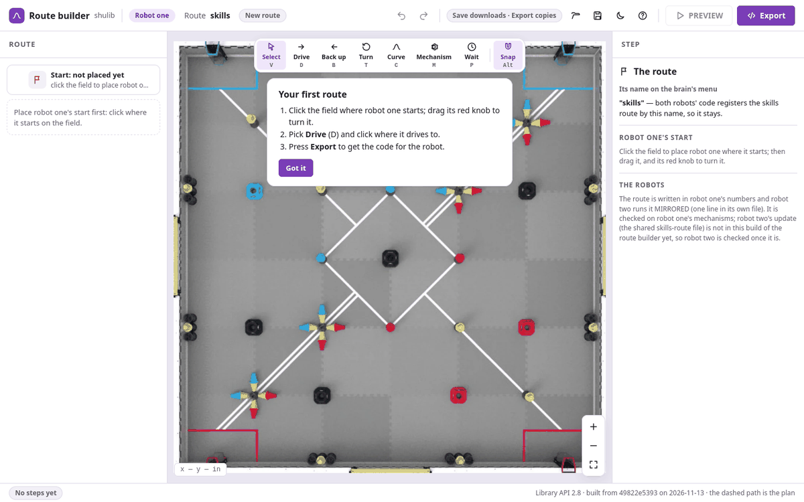
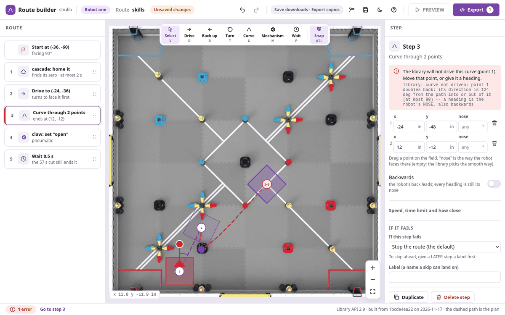
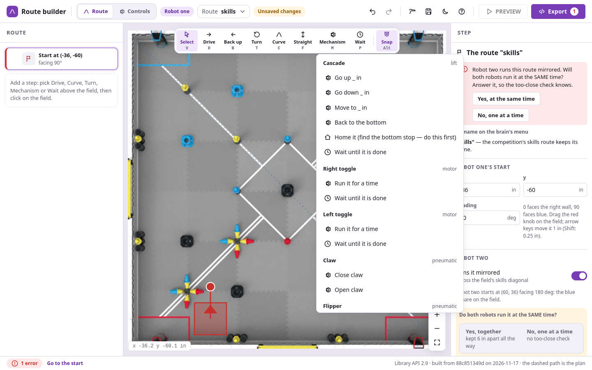
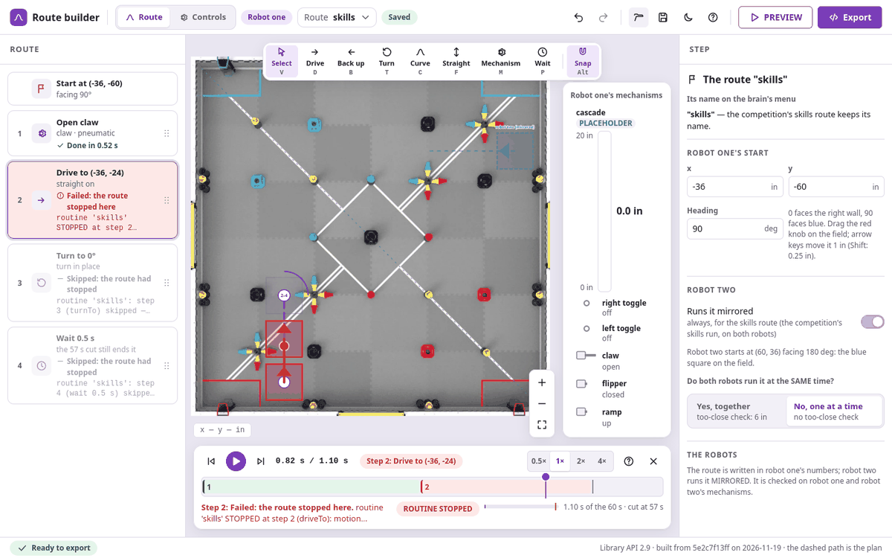
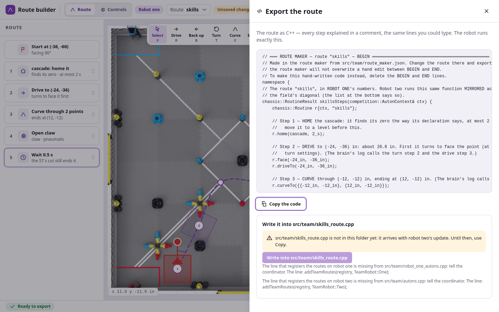
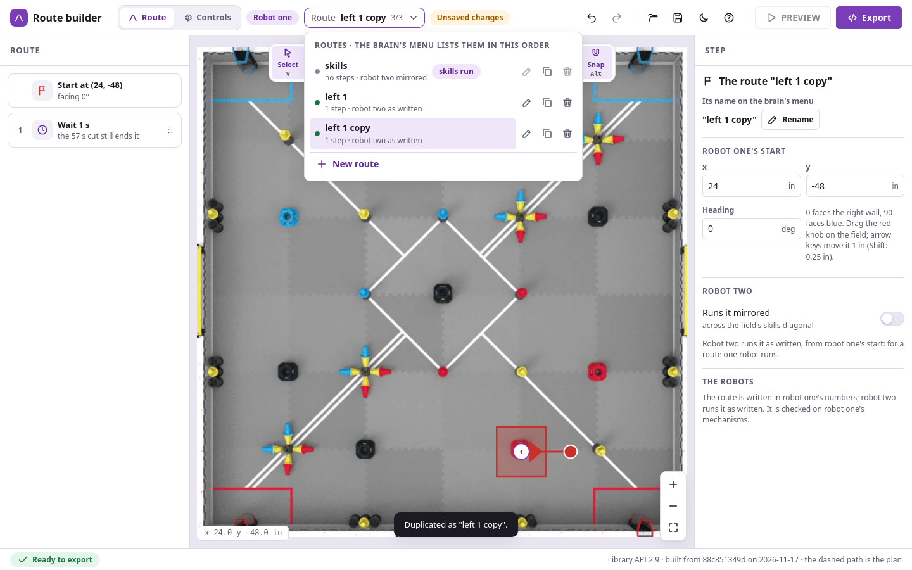
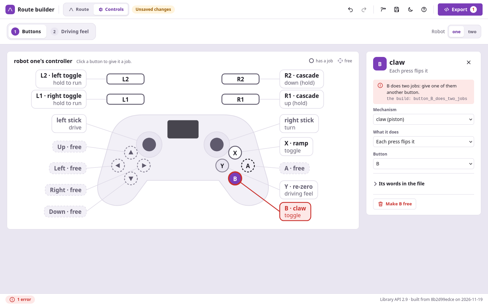
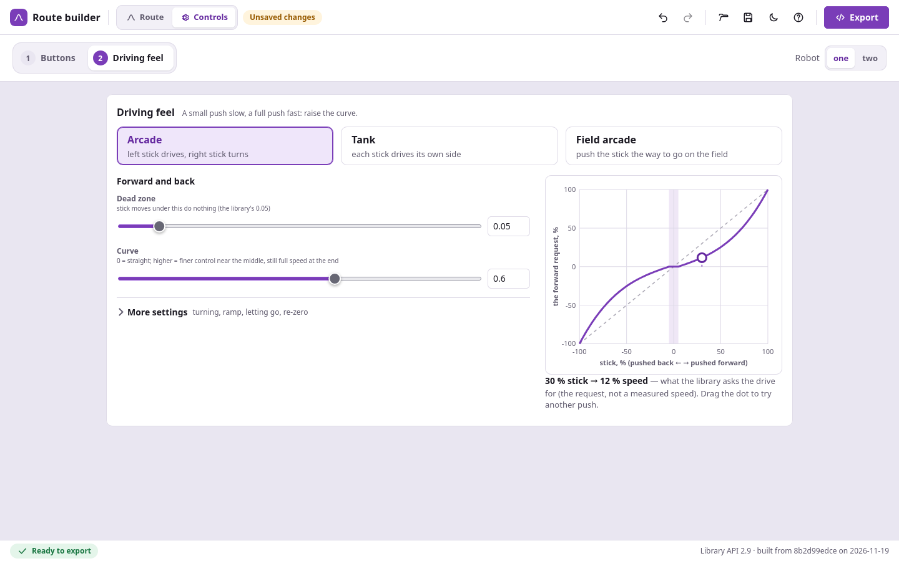
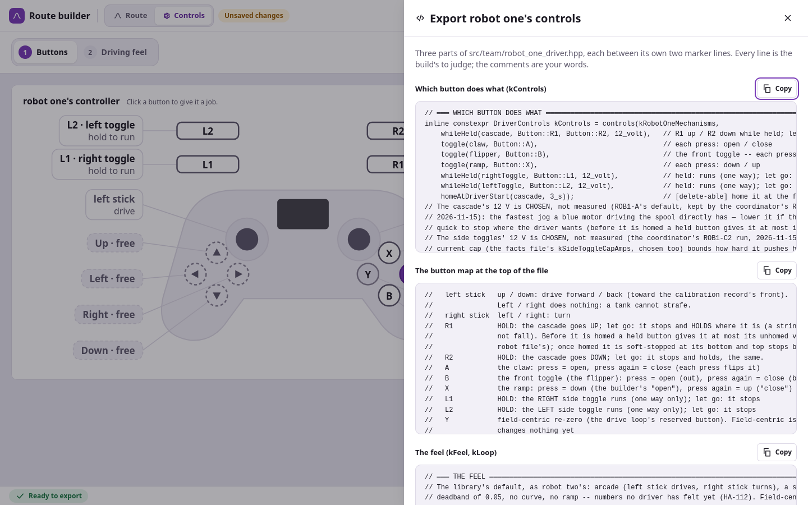
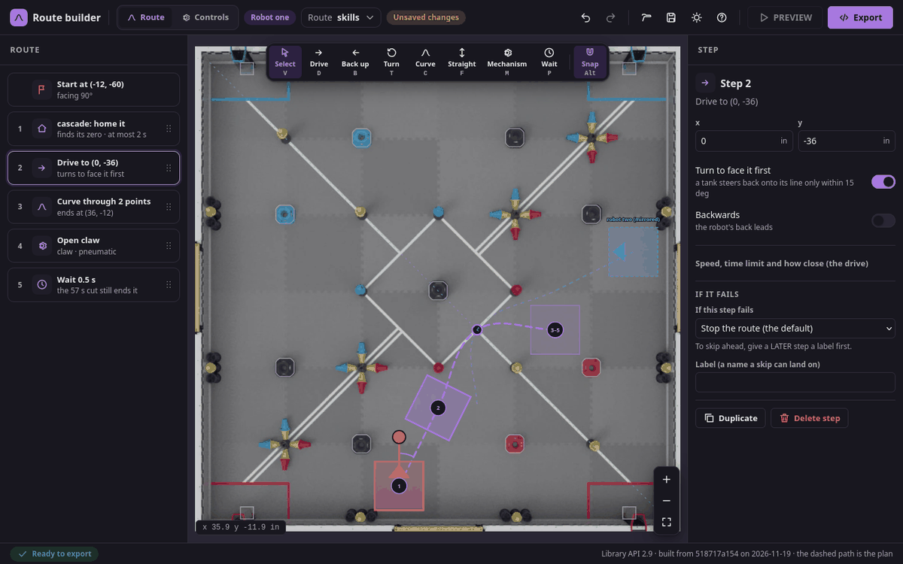

# 22 — Making your first route with the route builder

**Do this first:** [Set up your robot first](23-set-up-your-robot-first.md) — Bench Tests and Calibrate on the
robot, before you make a route.

The **route builder** is a web page where you build your team's routes — the skills route and any other you name —
by clicking on the real field, and get the C++ for the robot out of it. You place robot one's start, add steps — drive here, curve through there, open the
claw — and the page checks every step against the library's own rules as you go. When the route is right, you
export it into the robot's code. Every line it writes is commented in plain words; it is your route, and you
should be able to explain every line of it.

This chapter is in three parts: [your first route](#your-first-route), step by step;
[the driver's buttons and the driving feel](#the-drivers-buttons-and-the-driving-feel) — the **Controls** tab; and
[the reference](#the-reference) — every kind of step, every check, the shortcuts, and the project file.

The route and the buttons in the pictures are examples of **how to click**, not choices for the robot: where robot
one starts, where it goes and what each button does are your team's to decide.

## Your first route

### 1. Open it

Open **docs.shurobotics.com** and click the **Route builder** tab, then **Open the route builder**. Use **Edge or
Chrome** if you can: they can write the route straight into the shulib folder. Firefox works too — it downloads the
project and copies the code instead (Safari should do the same, but no test runs it). For the event, click
**Download for offline use** beforehand: it saves one file you double-click with no internet.

The field is the real Override skills field, **red at the bottom** — you are looking at it from behind the red
alliance station, as in [chapter 2](02-the-field-and-coordinates.md). Every number is in **inches** from the field's
centre: **+x to the right, +y away from you (toward blue)**. Headings are in **degrees**: 0 faces the right wall,
90 faces blue, -90 faces red.

### 2. Place robot one's start

Click the field where robot one starts. Its 15 in square appears in red, its **front** marked with a triangle. Drag
the square to move it; drag the **red knob** in front of it to turn it (it snaps to 15°; hold **Shift** for 1°). The
numbers are on the right, to type exactly.

**Robot two on the field.** The skills route is **mirrored for robot two**: robot two runs it reflected across the
field's diagonal (the dotted blue line). Its start and its path are drawn in blue, labelled **robot two (mirrored)**,
so you always see where it goes. On the right, the route asks once: **do both robots run it at the same time?**

- **Yes, together** (a skills run with both robots): the page checks that its plan keeps the two robots' squares
  **6 in apart** all the way, the start included — the plan, not the field: run them together slowly first
  ([chapter 17](17-the-competition-program.md#both-robots-at-once)). If they come closer, the step is red, both
  squares are outlined in red at that moment, and **They don't run at the same time** (it answers No) is one click
  away. At the start there is a second one-click fix, **Move the start … in away from the diagonal** (against a wall,
  **Slide the start … in along** it). On a step: keep robot one 3 in off the diagonal there, or send only one robot
  there with `isMirrored(ctx)` in the code.
- **No, one at a time**: the too-close check is off (a tank's half-turn step is still refused).

There is no default: until it is answered, Export waits (PREVIEW does not: it plays robot one). Robot two always
runs the skills route mirrored. For any other route, **Runs it mirrored** (on the right) turns the mirror off;
robot two then runs it as written, and nothing blue is drawn.

### 3. Add a drive

Pick **Drive** in the toolbar (or press **D**) and click where the robot should drive to. A dashed line shows the
plan, and a ghost square shows where the robot ends, facing along the line.

**"Turn to face it first"** is on: robot one's file declares it a tank, and a tank only steers itself back onto its
line when it starts within 15° of it. A drive that starts off its line **can** stop short of the point — on the host
test plant, 24 in legs up to 8° off their line arrived, but one 10° off already stopped short. So the step turns to
face the point, then drives. You can switch it off in the step's options on the right; the page marks the drive
amber (it may stop short) or red (more than 15° off: the library will not steer it back), and offers to switch it
back on:

A drive's speed, time limit and "how close" (on the right, under **Speed, time limit and how close**) are the
**drive's**: the turn to face the point first uses the robot's own settings.

The numbers on the field are the step numbers, at the spot where each step ends. Steps that end at the same spot
share one: **3–5** is the curve's end, where the claw opens and the robot waits.

**Small moves.** **Straight** (**F**) drives forward a number of inches from where the robot is — type it; switch
**Backwards** on to back up instead. The code is the point it reaches (`r.driveTo(…)` or `r.reverseTo(…)`), so it
follows when you move a step before it. To place a point exactly, type its **x** and **y** on the right, or select it
(a curve's point: click or drag it on the field) and press the **arrow keys**: 1 in a press, **Shift** for 0.25 in.
Zoom in (**+**) and two points 1 in apart are two handles.

### 4. Add a curve

Pick **Curve** (**C**) and click the points the robot should pass through — up to 16 — then press **Enter** or
double-click. The dashed curve is the library's **own** curve (the same maths the robot follows), not a drawing of
it. Drag any point to change it. A point can have a heading — the way the robot's **nose** points there — or none,
and the library picks the smooth way.

A curve the library would refuse is red, with the point it refuses named, in plain words and in the library's own
sentence — here the path into point 1 doubles back on itself:

### 5. Work a mechanism

Pick **Mechanism** (**M**): the menu lists robot one's mechanisms by name, each with what it can do. A claw, a ramp
or a flipper has one button per position: **Open claw**, **Close claw**, **Ramp down**. (The route in the pictures
also homes the cascade first: **Cascade → Home it**, with its time limit typed, before the first drive.)

**The cascade, in inches.** **Go up _ in**, **Go down _ in**, **Move to _ in** and **Back to the bottom**: type the
inches and the most time it may take. The library moves a lift to a height, not by an amount, so the page keeps
track of where the cascade is at every step — after a home it is at the bottom, after "move to 18" at 18 — and
writes each step as the height it reaches, its own words in the comment (*"Step 4 — MOVE the cascade UP 6 in, to
18 in"*). On the right, each step says **from** where **to** where. "Go up" before anything says where the cascade
is, or past the top of its travel (the step says the range), is red, with its fix. An arm turns up and down in degrees the same
way. Once the cascade has levels (recorded at **Bench Tests station 13**), **Move to a level** appears too; the code
names a level by its number in robot one's facts, so the route does not change when a level is renamed.

The cascade only knows where its bottom is once it has been **homed** — pushed gently down until it stalls on its
stop. A move before that stops the whole route (`NOT_HOMED`), so the page marks such a move red and offers **Home it
first** (a home step at the start of the route — **type its time limit yourself**: the page never invents one) or
**Home it while the first leg drives** (the home starts at the beginning, and a "wait until done" finishes it before
the cascade's first move).

### 6. PREVIEW: watch the library drive it

Press **PREVIEW** (top right, or **Ctrl+Enter**). In about a second the robot drives your route on the field. It is
not a drawing: the page runs the **real library** — the same code the robot runs — on the **host test plant**, the
library's own model of a drive, and plays back what it did. The path the robot drove is solid; your plan stays
dashed beside it, so you see where the robot went differently from the plan.

**The timeline** across the bottom shows each step's span in the colour of how it went: green done, red failed,
amber cut by the 57 s mark, grey skipped; a step too short to see at this scale is a thin mark at its moment. Play and pause with **Space**, go to the step before or after with
**Left** and **Right** (with **Shift**, 0.1 s at a time), to the start or the end with **Home** and **End**, and
choose the speed (½×, 1×, 2×, 4×). Drag along the timeline, or click a step in the list to go to where it began.
The small bar on the right is the run against the 60 s, the 57 s cut marked.

**The mechanisms** move beside the field, in step with the robot: the cascade's height on a bar (its bottom and top
marked, and while its step plays, the height it is going to), each piston's position (the claw open or closed), and
each toggle's motor, lit while it runs, with its direction. The mechanism the playing step uses is highlighted.
A step that only starts a mechanism ("keeps going") is not highlighted while the robot drives on, but its bar still
moves. Like the drive, their heights and times come from the host test plant.

**The steps** on the left say how each one went, and the one playing is highlighted. A step that failed is red,
with the library's own line under it — the line the brain's log would show. A step in which the robot would go
**through a wall** is red too, saying where (the host test plant has no walls, so the page checks the robot's square
against the real field); the steps after it are grey, and the robot is drawn faded from that moment: on the field it
would not get there.

**Robot two.** PREVIEW plays robot one; robot two's mirrored run is not in it yet, and **About this run** says
so. Whether the two robots stay apart is checked while you build (step 2), for a route both run at the same time
([chapter 17](17-the-competition-program.md#both-robots-at-once)). PREVIEW does not wait for that answer, nor for a
too-close start or step: robot one runs the route the same either way.

**What the host test plant is not.** It is a stand-in drive — a 12 in tank with made-up gains, not your robot's —
with no walls, and every number robot one's facts file has not measured yet is a **PLACEHOLDER**: the steps that
used one say so, and **About this run** (the **?** button beside the speeds) lists them, with every line the library
printed. A mechanism still on the library's starting gains is marked **PLACEHOLDER** beside the field too (point at
the mark for why; **shulib Tune** sets the real ones on the robot,
[chapter 18](18-mechanisms.md#the-tune-program--tuning-on-the-brain-screen)). The steps, their order and what the
library refuses are the library's; the times and the exact path are the host test plant's. Time the route on the
robot with **shulib Auton Tester** ([chapter 16](16-testing-an-auton-on-the-bench.md)).

PREVIEW runs the route on the page, saved or not. Change the route and the run is put away (an undo brings it
back); press PREVIEW again. A route with a red step is not run — fix it first (robot two's red waits only for Export). **Cancel** stops a PREVIEW that is
running; one that takes longer than 20 s is stopped, and the page says so.

### 7. Export

When the bottom bar says **Ready to export**, press **Export** (**Ctrl+E**). While a step is still red, a red number
on the Export button counts what is left, and Export shows only that list — each with **Go there** — and no code.

- **In Edge or Chrome**, click **Connect your shulib folder** once (here, or the folder button in the top bar) and
  pick the repository's top folder (the one with `src/team/` in it). Then **Write into src/team/skills_route.cpp** puts the route between the two
  `ROUTE MAKER` lines of that file — and changes nothing else in it, keeping its own line endings.
- **In another browser**, **Copy the code** — or pick your `src/team/skills_route.cpp`: the page writes the
  updated file back as a download, to save in its place. **Then Save** (step 8): the project file remembers what
  was exported, so the next export knows that code is the builder's.

Export writes **every route** of the project (step 9) between the two `ROUTE MAKER` lines, and a red step on any of
them stops it — the list names the route, and **Go there** opens it. One line in each robot's autons file registers
them all: `addTeamRoutes(registry, TeamRobot::One);` in robot one's, `...::Two` in robot two's, which runs each route
marked mirrored **mirrored** across the field's diagonal. The export page checks both lines are there and says so. (A copy of the repository from before robot two's update, 2026-11-17,
has no `src/team/skills_route.cpp`: the page then offers Copy only — the picture above.)

#### Reading the code

Everything between the two `ROUTE MAKER` lines is the route, and every step is a comment, then its code — step 2
in the picture above, for one:

- **The comment** says what the step does in plain words, with its numbers, and the page's step number first:
  *Step 2 — DRIVE to (-24, -36) in: about 26.8 in. First it turns to face the point …*
- **The code** is the library's own calls (`r.` is the route being built), every number with its unit: `_in`
  inches, `_deg` degrees, `_s` seconds, `_volt` volts. A drive that turns first is two calls — `r.face(…)`, then
  `r.driveTo(…)`. A position is `claw["open"]`; a level, once the cascade has levels, `cascade[facts::lv(2).name]` —
  level 2 of robot one's facts.
- **The brain's numbers.** If the route stops on the robot, the brain's log says `STOPPED at step N` with the call's
  name. A drive that turns first is TWO calls, so the brain counts one step more than the page for each such drive
  — and wherever the two numbers differ, the comment says the brain's too (*"The brain's log calls the turn step 2
  and the drive step 3."*).
- **Above the steps:** the `Routine` that runs them, named for the route. **Below them:** the route's entry — the name
  on the brain's menu, robot one's start, and the 60 s skills timing (stop at 57 s, everything off at 59 s). Each
  route has its own steps and entry; at the end, **one list** (`kTeamRoutes`) of every route in order, each with
  `Mirror::ForRobotTwo` or `Mirror::None` and `Together::Yes` or `Together::No` (the answer from step 2: the host
  suite checks the two robots stay apart only on `Yes`).

You should be able to explain every line; if one surprises you, ask before you run it.

Then build and upload as always ([chapter 16](16-testing-an-auton-on-the-bench.md)), and run the route in
**shulib Auton Tester** on the robot.

### 8. Save

**Save** (**Ctrl+S**) writes the project — your route, step by step — to `src/team/route_maker.json` (Edge or
Chrome, with the folder connected) or downloads it (put it in `src/team/`). **Open** reads it back. Commit it with
the code: it is how anyone carries on from where you stopped.

Until you save, the page keeps a draft in this browser, and says so when you come back (if it ever cannot show that
draft, it opens a new route and says so; your `route_maker.json` is not touched). With the folder connected,
it compares itself with the folder's `route_maker.json` — after a `git pull` brought a teammate's route, it asks
which to keep — and **Save** never replaces a `route_maker.json` that changed in the folder without asking.

### 9. More routes

The button in the top bar (**Route skills ⌄**) holds the project's routes: the skills route, a test route, a
practice route, each picked **by its name** on the brain's **Auton Tester** menu. Click it to switch routes (one is
on the field at a time), and for **New route**, **Rename**, **Duplicate** and **Delete** (Delete asks first; **Ctrl+Z**
brings a route back).

A name is what the brain's menu shows: 1 to 29 plain characters (25 for a mirrored route, which robot two shows as
`<name> SKILLS MIR`), no `%`, `"` or `\`, not `NONE`, and no two routes named alike (capitals aside) — nor like
the menu's other two autons, `40in forward` and `TEST 24in turn back`. The box says why as you type, and **OK**
waits. The **skills** route — the competition's — keeps its name and is always there. The brain's menu holds 16
autons, and those two take 2: at most 14 routes.

## The driver's buttons and the driving feel

**Quick start — the Controls tab in 5 steps**

1. Click **Controls** in the top bar: robot one's controller.
2. Click a button, then pick its job (a dashed button is free).
3. Set the feel: the dead zone and the curve.
4. **Export** (**Ctrl+E**) → **Write into src/team/robot_one_driver.hpp**.
5. Pick robot **two**, do the same, then build and upload.

<video controls preload="metadata" poster="../assets/video/controls-tab.jpg" src="../assets/video/controls-tab.mp4" style="max-width:100%"></video>

Music: "Wallpaper" by Kevin MacLeod ([incompetech.com](https://incompetech.com)), licensed under [Creative Commons: By Attribution 4.0](https://creativecommons.org/licenses/by/4.0/). Voice: Kokoro.

The **Controls** tab (top bar, beside **Route**) sets what each button does in driver control and how the sticks
feel, in two steps — **1 · Buttons** and **2 · Driving feel** — one on the screen at a time. It edits robot one's
driver file, `src/team/robot_one_driver.hpp` (or robot two's — pick **one** or **two** at the right of the steps). It
opens with the driver file as it was when this page was published (with nothing clicked, the panel beside the
controller gives the date); with your shulib folder connected (Edge or Chrome) it reads today's file. Once you change a robot's
controls, your project file keeps them, and the tab opens with those. It changes only what you change. Connecting
the folder or opening a project keeps a change made here: when this page had no route yet and the folder's project
has no controls for that robot, your change stays; otherwise **Ctrl+Z** on this tab brings it back. The one
exception is a project whose controls for that robot this page cannot read (a newer route builder's): the tab then
shows the driver file, read only, and your change there is gone. The page says which.

### Step 1 · Buttons

The picture is the V5 controller. Each button's label says its job; a **dashed** button is free, and Y is the
drive's re-zero button. Click a button (or its label) and the panel beside the controller (under it, in a narrow
window) shows that one job — its button (both, for a pair) is the only one highlighted on the controller (a button
with a problem stays red). **Esc** or **×** closes it. With nothing clicked, the panel lists your mechanisms and their
buttons, and says in a sentence any job that needs no button ("The cascade homes by itself when driver control
starts").

- **Give a free button a job:** click it, pick the mechanism, then pick the job. Each job says exactly what it picks
  (**Move while held: Up up, Down down**; **Go to "open" on one press**). Then finish it in the panel — the volts of a
  hold (12 is full power), the level and its time limit, or the second button of a pair when its partner is taken.
- **Change a job:** click the button. The panel shows the mechanism, what it does, its button, its volts or time
  limit, and **Make X free** (both buttons of a pair: **Make R1 and R2 free**).
- **A job with no button:** click the mechanism in the panel's list — "home it when driver control starts", or
  "autons only".
- **The words:** the comment on its line and its row in the button map at the top of the file are yours to
  reword (in the panel, under **Its words in the file**). Change what a control does and both become the page's words
  again (**Ctrl+Z** brings yours back); move it to another button and yours are kept.

| Mechanism | What a button can do |
|---|---|
| a motor (robot one's side toggles) | run while held — one button forward and one back, or one button, one way |
| an arm or a lift (the cascade) | move while held (one button up, one down); go to a level on one press; home it on one press; home it when driver control starts (no button) |
| a piston (the claw, the flipper, the ramp) | each press flips it; go to one position on one press |
| a flywheel | each press spins it up to a named speed or stops it; spin up to a speed on one press |
| any | autons only: no button in driver control |

**What the page refuses** — what the build refuses, in plain words, with the build's own name beside them:
a button doing two jobs (`button_B_does_two_jobs`), a hold's volts not above 0 or above 12, a level or a home with
no time limit, a level the mechanism does not have, a mechanism with no button (choose "autons only" if that is
meant), a control on the re-zero button, more than 24 controls, and an arm or lift that must be homed with no way to
home it in driver control. It also asks for what is not finished yet — a button, a level, or the second button
of a pair it does not choose for you. Export lists them, each with **Go there**. The button map at the top of the
file is written from the same choices: each control's rows sit where its buttons are, in the code's order. Its
words are yours. Give a free button a job and a map line calling it free (the d-pad FREE line, once Up has a job)
goes in the same click — the page says so, and one **Ctrl+Z** brings both back. The page stops on words it can tell
are wrong now — a line like that already in the file (**Remove that line**), or words naming a button whose job
changed after they were written — the file's or yours (**Use the page's words** replaces only that comment or row) —
and asks you to check a note in the file that speaks of a mechanism or button you changed. Words it cannot judge are
yours to keep true.

### Step 2 · Driving feel

"Move the stick a little and the robot goes slowly, but still moves; push it all the way and it goes fast" — that
is the **curve**. Click **2 · Driving feel** (or a stick on the controller). First, the essentials:

- **The style** — **Arcade** (the left stick drives, the right stick turns), **Tank** (each stick drives its
  own side) or **Field arcade** (push the stick the way to go on the field, whichever way the robot faces).
- **Dead zone** — a stick moved less than this does nothing (the library's default is 0.05).
- **Curve** — 0 is straight: half a push asks for half speed. Higher gives finer control near the middle and still
  full speed at the end.

The rest waits under **More settings** (closed at first):

- **Which stick direction** the dead zone and curve shape — **Forward and back**, **Turning** (and **Sideways** on a
  robot that can strafe). The heading above them says which.
- **Ramp** — how quickly the request may change: at 4 per second, "full speed from rest in 0.25 s" — and a stop from
  full speed takes as long, so with a ramp the robot does not stop the instant the sticks are let go. 0 is no ramp.
- **When the sticks are let go** — the drive coasts, brakes or holds; **the re-zero button**; and **Use the library's
  defaults**.

The graph is the library's own formula — the same numbers as the library's C++, checked on the host at 9 630 points:
how far the stick is pushed along the bottom, what the library asks the drive for up the side. Drag the dot to try
a push: "30 % stick → 12 % speed". It is the REQUEST, not a measured speed. In **Tank** both sticks are first
averaged into a forward request, (left + right) / 2, and a turn request, (right − left) / 2; the curve shapes those.
A dead zone of 1 or more, or a curve outside 0 to 1, is refused by the page and by the build (`the feel is out of
range`). When "shulib Drive" starts, it prints the feel it runs (its `driver feel:` line, made from the driver file).

### Export the controls

**Export** (**Ctrl+E**) on the Controls tab shows the three parts of the driver file it writes, each with **Copy**:
which button does what (`kControls`), the button map at the top of the file, and the feel (`kFeel`, and the re-zero
button and what the drive does when let go). With the shulib folder connected (Edge or Chrome), **Write into
src/team/robot_one_driver.hpp** changes only the lines between the file's three pairs of marker lines —
`// [driver file one]`, `// [control words one]` and `// [feel one]`, each with its `[/…]` partner — and keeps the
file's own line endings. A part someone changed by hand since the last export is not replaced unless you choose
**Overwrite**. In Firefox or Safari, **Pick robot_one_driver.hpp** gives the updated file back as a download, with
the same check. A driver file without the `control words` and `feel` markers (a copy from before robot two's
update) can only be copied. **Undo** and **Redo** (**Ctrl+Z**, **Ctrl+Shift+Z**) work on this tab too, on the
robot shown.

Then build as usual: the build is the final judge of every line.

## The reference

### The steps

| Step | Toolbar | What it does | The C++ it writes |
|---|---|---|---|
| Start | click the empty field | where robot one is placed, and its heading | `e.start = competition::StartPose::field(x, y, h)` |
| Drive | **D**, click | drives to a point, arriving facing along the line; on a tank it turns to face the point first | `r.face(x, y);` `r.driveTo(x, y);` |
| Straight | **F**, type the inches | drives forward (or, **Backwards** on, backs up) that far from where the robot is | `r.driveTo(x, y);` / `r.reverseTo(x, y);` — the point it reaches |
| Back up | **B**, click | the same, backwards (its back turned to the point first) | `r.faceAway(x, y);` `r.reverseTo(x, y);` |
| Turn | **T**, click | turns in place to face a point, its back to a point, or to a heading | `r.face(x, y)` / `r.faceAway(x, y)` / `r.turnTo(h)` |
| Curve | **C**, click 1–16 points, Enter | one smooth path through the points (forwards or backwards) | `r.curveTo({...})` / `r.reverseCurveTo({...})` |
| Mechanism | **M** | a lift up, down or to a height in inches, or back to the bottom (an arm in degrees), or to a level; a pneumatic's position (its own button); a motor for a time; a home | `r.move(cascade.to(18_in), t)`, `r.move(arm.to(90), t)`, `r.startMove(...)`, `r.set(claw["open"])`, `r.run(...)`, `r.home(...)` |
| Wait until done | **M** → the mechanism | waits for the mechanism's last step | `r.waitUntilDone(m, t)` |
| Wait | **P** | a pause in seconds — the run's own wait, so the 57 s cut still ends it | `r.then([&] { return ctx.guard.pause(t) ... })` |

Every step also has **If it fails** — stop the route (the default), carry on, or skip ahead to a step you gave a
**label** — and, on a drive or a turn, its time limit, top speed, turn speed and how close it must arrive (empty
means the robot's own; on a drive that turns first, they are the drive's). A number box takes plain digits — `2.5`,
not `2.5s`: anything else is marked and not kept.

A height is written as the library's constant target — `cascade.to(18_in)`, an arm's `arm.to(90)` (a plain number:
the library refuses `_deg` there) — from the height the page tracked; the step's own words ("UP 6 in, to 18 in") are
in its comment. A level of the cascade is written through the robot's facts — `cascade[facts::lv(2).name]` — so
renaming a level in the facts file never breaks a route; the cascade has no levels yet (they are recorded at Bench
Tests station 13), and a move to a level in a project file from before is red, with the same words.

Not yet in the route builder (they come in its next updates; until then they are typed by hand inside the region,
and the page never overwrites a hand edit): triggers partway through a drive, wall resets, the time bar, and the
Toggle steps.

### The checks

A **red** step is one the robot would refuse — the library would not build it, or would stop the route on it. Until
every red step is fixed, Export shows only the list of them (each with **Go there**), and the bottom bar goes to the
first one. An **amber** step is a warning: it runs, but probably not as you mean. Each check says what is wrong in
plain words — with the library's own sentence underneath where the library has one — and where there is a
one-click fix it offers it.

| The check | Red when |
|---|---|
| Inside the field | the robot's 15 in square would go more than 1 in into a wall — at a point, turning in place, or anywhere along a curve |
| The start | there is no start, a number of it is missing (a `route_maker.json` edited by hand: the list shows `?` for it, and the robot is drawn once you type it), or it is through a wall |
| Turn first (tank) | a drive is not turned first and starts more than 15° off its line (amber from 0.5°) |
| The curve | the library refuses it: its first point is behind the robot, two points are closer than 1 in, a point doubles back (amber: a bend tighter than the robot can follow) |
| Home first | a cascade (or any arm or lift homed by a stall or a switch) is moved before a FINISHED home on every way the route can go |
| Wait until done | nothing before it starts that mechanism, or a skip can pass over the step that does |
| Levels and positions | the mechanism, the level or the position is not on the robot (or the mechanism has no levels yet) |
| Heights | a "go up" or "go down" where the page cannot know the height (nothing homed it or moved it to a height before: **Home it first**), or a height past the travel (one click: only as far as the top, or back to the bottom) |
| Both robots together? | a mirrored route has no answer yet (**Yes, at the same time** / **No, one at a time**, one click) |
| Too close | answered **Yes**: the two robots' squares come closer than 6 in at the start or on a step — the step, the moment and both places said, both squares outlined |
| Time limits | a time limit is empty or not above 0; volts outside -12 to 12 |
| Labels and skips | two steps with one label, or a skip to a label that is not on a LATER step |
| The name | a name the brain's menu cannot show, one with `"` or `\` or a space at an end, two routes named alike (capitals aside), more than 14 routes, or a project with no `skills` route (offers **Name it "skills"**) |
| A newer project file | opening a `route_maker.json` made by a newer route builder (a step, or a field of the route, this one cannot write): refused by name, nothing opened. A robot's Controls this one cannot read open read only instead (the Controls tab) |

### The keyboard

| Keys | |
|---|---|
| **V** or **Esc** | select (and cancel what is being added) |
| **D**, **B**, **T**, **C**, **F**, **M**, **P** | drive, back up, turn, curve, straight, mechanism, wait |
| **Arrow keys** | move the selected point 1 in (**Shift**: 0.25 in) |
| **Delete**, **Ctrl+D** | delete, duplicate the selected step |
| **Ctrl+Z**, **Ctrl+Shift+Z** | undo, redo |
| **Ctrl+S**, **Ctrl+E** | save, export |
| **Ctrl+Enter** | PREVIEW |
| **Space** (a tap), **Left**, **Right** | in the preview: play or pause, the step before or after (**Shift**: 0.1 s) |
| **Home**, **End**, **Esc** | in the preview: its start, its end; close it |
| **Alt+Up**, **Alt+Down** | move the selected step in the list |
| **+**, **-**, **0** | zoom in, out, fit the field |
| **Space** + drag | pan |
| **Alt** while placing or dragging | no snapping |
| **?** | the list in the page |

Points snap to the half-tile grid (every 12 in) and flush against a wall; headings snap to 15°.

### The project file

Save writes `src/team/route_maker.json`. It holds every route, in order, in the same units you see — inches,
degrees, seconds, volts — one step per entry, in a fixed order so a change shows as a small `git diff`, and for a
mirrored route the answer to "both robots at the same time?" (`together`). It also remembers a fingerprint of the
code it last exported, so that if someone edits the code between the `ROUTE MAKER` lines by hand, the next export
asks before replacing their change (**Keep their change**, or **Overwrite**). **Deleting the two `ROUTE MAKER`
lines** makes the routes hand-written code that the route builder leaves alone from then on. A project file from
before named routes (one route, `skills`) opens as it is, and asks the step-2 question.

Once you change a robot's buttons or feel on the **Controls** tab, the project file also holds that robot's controls
and feel (under `robots`, with a fingerprint of each part of its driver file it read or wrote), and from then on
the tab shows the project's, exported or not.

