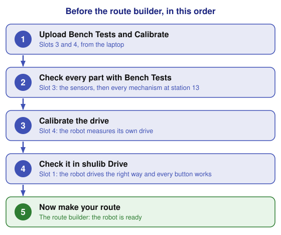

# Set up your robot first

Before you make a route, the robot has to know two things about itself: which way every mechanism
moves, and how its drive is wired. **Bench Tests** checks the first and **Calibrate** measures the
second. A route made on a robot that skipped them drives the wrong way, or not at all.

Do the five steps below in order, on each robot, before anyone makes a route for it.



Watch it first — about 3½ minutes, with a voice and quiet music.

<video controls preload="metadata" poster="../../assets/video/setup-first.jpg" src="../../assets/video/setup-first.mp4" style="max-width:100%"></video>

Music: "Wallpaper" by Kevin MacLeod ([incompetech.com](https://incompetech.com)), licensed under [Creative Commons: By Attribution 4.0](https://creativecommons.org/licenses/by/4.0/). Voice: Kokoro.

## What you need

| What | Notes |
|---|---|
| **The robot** | fully built and cabled, on the floor |
| **A charged battery** | in the robot |
| **The controller** | paired to the brain |
| **An SD card** | in the brain — Calibrate saves its measurement there |
| **Tape on the floor** | one straight line, **48 in or longer**, with clear floor around one end |
| **Two people** | one at the controller or the screen, one watching the robot |
| **A laptop** | with PROS and the shulib folder ([Build and upload the programs](07-getting-set-up.md)) |
| **The robot facts form** | printed, and a pencil ([the robot facts form](../robot-facts-form.md)) |

## 1. Upload Bench Tests and Calibrate

*Slots 3 and 4, from the laptop*

Plug the brain into the laptop with a USB cable. **The easy way:** in VS Code, **Terminal → Run Task → Upload
everything to White Bot (robot one)** (or **… to Black Bot (robot two)**) puts all six programs on the robot, each in
its slot, and ends with a ✓ or ✗ line for each. (Not the PROS extension's own Upload button: it builds the bench bot's
test program.) Or, in a terminal, in the shulib folder, build and upload these two for **your** robot:

| Robot | Build word |
|---|---|
| robot one | `ROBOT=one` |
| robot two | `ROBOT=tank` |

Robot one:

```sh
make ROBOT=one
pros upload --slot 3 --name "Bench Tests" --description "$(git describe --always --dirty)"
make ROBOT=one PROGRAM=calibrate
pros upload --slot 4 --name "shulib Calibrate" --description "$(git describe --always --dirty)"
```

Robot two: the same four lines with `ROBOT=tank` in place of `ROBOT=one`.

If `make` stops with a list of facts it still needs, nothing was uploaded. Give that list to whoever
types your robot's facts.

## 2. Check every part with Bench Tests

*Slot 3: the sensors, then every mechanism at station 13*

On the brain, open **Bench Tests** (slot 3) and run it. A menu of 13 tiles appears; a tile with a red
edge powers motors. Each tile's dot fills in with its result once it has run. Do these five, in this
order:

| Tile | What you do | It passes when |
|---|---|---|
| **1 DEVICE CENSUS** | nothing — just read it | every motor, the IMU and the camera are on the port your form says |
| **4 BATT/CTRL** | pair the controller if it says NOT CONNECTED | the controller reads CONNECTED |
| **5 SD CARD PROBE** | nothing | all three steps pass. If not, reformat the card as FAT32 |
| **2 IMU + ROTATE** | turn the whole robot counter-clockwise (to its left) | the big number rises while you turn |
| **13 MECH POWERS** | the steps below | every mechanism has a verdict and the cascade is measured |

### Station 13: the controls

Nothing at station 13 moves unless **L1 is held**. Let go of L1 and everything stops at once.

| Press | What it does |
|---|---|
| **L1** (hold it the whole time) | allows power. Let go and it stops |
| **UP** / **DOWN** | jog the mechanism while held. A piston: UP fires it |
| **R1** | more volts: it starts at 3 V, then 6, 9 and 12 V |
| **A** | checks which way the mechanism moves |
| **NEXT** (screen) | the next mechanism |
| **RECORD** (screen) | writes every reading to the log and the SD card |
| **DONE** (screen) | everything safe, back to the menu |

**The line under the mechanism's name always says what to do now.** Read it first, every time.

### Station 13: each mechanism's direction

1. Touch **13 MECH**. The screen asks **STATION 13 POWERS MECHANISMS** — every path clear,
   hands away? Clear the robot, then touch **YES, CLEAR**.
2. The page shows one mechanism, its name at the top. Hold **L1**, then press **UP** once.
3. The screen asks **POWER 'cascade'?** (or the mechanism's name). Keep holding L1 and touch
   **YES, POWER IT**. You answer this once for each mechanism.
4. With the mechanism still, press **A**. The screen counts down — *Watch it: it moves + in 1.0 s* —
   then the mechanism moves a little.
5. Touch what you saw: **ITS + WAY**, **THE OTHER WAY**, or **NOT MOVED / ELSE MOVED**. The + way of
   the cascade is **up**.
6. The screen shows the verdict: **OK**, or a word like **REVERSED** with the line of the robot file to
   change. Write it on the form.
7. Touch **NEXT** for the next mechanism, and do it again from step 2.

A piston is checked by firing it: hold L1 and press **UP**. It asks **FIRE 'claw' -> 'open'?** every
time — touch **YES, FIRE**, watch it, then touch the position it went to.

### Station 13: measure the cascade

The cascade's page lists these steps, numbered, with a `>` beside the one you are on. Each RECORD moves
it to the next.

1. Start with the cascade resting on its **bottom stop** (it usually is when the robot is switched on;
   if not, jog it DOWN gently and let go as it lands). Touch **RECORD**.
2. If your cascade has levels: jog it up to each level, tape the height, and touch **RECORD**.
3. The **top stop**: hold UP at 3 V. If it does not rise, press R1 for 6 V. A jog stops by itself after
   3 s: let go of L1, hold it again and press UP again. **Let go of UP the moment it stops rising** —
   never keep pushing into the stop. Tape the height, then touch **RECORD**.

After each RECORD the screen shows, large, the number it wrote:

```text
REC 2: cascade output +3759.04 deg
```

**Write down the `output … deg` number** — that is the one that gets typed, not the inches. Tape the
heights from the point on the top stage your form names (item 11).

The bottom line of the page reads like `3 V now (R1 for more); cap 2.0 A`. The cap keeps the cascade's
string safe. If it says **cap 2.0 A NOT SET**, stay at 3 V and tell whoever types your robot's facts.

### Station 13: the side toggles and the pistons

- **Side toggles**: run each one **briefly**, never held against its stop. The page shows its port
  (`motor 1 (port 9)`). Watch which arm moves: that tells you which port is the **right** toggle. Write
  down which way each one runs (toward the front, outward, …).
- **Pistons** (claw, front toggle, ramp): fire each once, as above, and answer where it went. Letting go
  of L1 puts it back in its safe position. Write down: the claw went **open** or **closed**; the front
  toggle went **out** or **back**; the ramp went **down** or **up**.

### Station 13: when it stops by itself

| The line under the name says | Do this |
|---|---|
| `Stopped at 3 s: let go of L1, then hold it again` | a jog lasts 3 s at most. Let go of L1, hold it again, go on |
| `Its motors FIGHT: DONE, then open 13 again` | touch DONE, then open 13 again. If it happens again, check that the two motors are wired the same way and tell whoever types your robot's facts |
| `Drew too much current: DONE, then open 13 again` | touch DONE, then open 13 again. Check nothing is jammed |
| `It STALLED: DONE, then open 13 again` | touch DONE, then open 13 again. Check nothing is jammed |
| `It did not move at 3 V -- press R1 for 6 V` | press R1 and try again |
| `Not found on the brain: check its cable, or NEXT` | re-seat its cable, or touch NEXT and report it |
| `Pair the controller to the brain: it has no link` | pair the controller |
| `Controller says FIELD: unplug the cable or re-pair` | unplug the field cable, or re-pair the controller |

### Robot two: the quick pass

Robot two is the same build as robot one, so it already has robot one's measured numbers. On robot two, do
only this:

1. **Tile 1 DEVICE CENSUS**: every motor is on the port the screen expects.
2. **Station 13, each motor mechanism** (the cascade, then each side toggle): the direction check with **A**.
   For a side toggle, also note which arm moved: that is the **right** one or the **left** one.
3. **Station 13, each piston** (claw, front toggle, ramp): fire it once and touch where it went.
4. **Skip "measure the cascade"**: robot two uses robot one's heights.

Send the six answers (step 2's three verdicts, step 3's three positions). Robot two's programs already build on
robot one's answers (the team lead, 2026-11-20); an answer that differs is typed as robot two's own.

### What to send

Write each answer on [the robot facts form](../robot-facts-form.md), with **who**, **how** and **the
date**, and hand it to whoever types your robot's facts:

| What | Where you read it | Form item |
|---|---|---|
| Every mechanism's direction verdict (OK, or the line it names) | station 13, A | 8, 21 |
| The cascade's **bottom stop**: its `output … deg` | station 13, RECORD | 14 |
| Each **level**: its taped height and its `output … deg` | station 13, RECORD | 14 |
| The cascade's **top stop**: its taped height and its `output … deg` | station 13, RECORD | 14 |
| Which side toggle port is the **right** one, and which way each runs | station 13 | 21 |
| The claw: open or closed. The front toggle: out or back. The ramp: down or up | station 13 | 22, 23, 24 |
| Calibrate's **SAVED** screen, from **both** runs (a photo of each) | Calibrate (step 3) | — |

## 3. Calibrate the drive

*Slot 4: the robot measures its own drive*

Calibrate finds which ports drive, which way each turns, which side each is on, the wheel scale and the
track width. You only push the robot once along the tape.

**Before you start:**

- The **SD card** is in the brain. Without it nothing is saved.
- The robot is **on the floor** (not on blocks), at one end of the tape, **front end pointing along
  the tape**. The front is the end your autons call the front (form item 5).
- The floor around the robot is clear: it turns in place later.

**One run:**

1. On the brain, open **shulib Calibrate** (slot 4) and run it.
2. **1/4 IMU — HANDS OFF.** Do not touch the robot for about 2 seconds. The screen reminds you: *the
   end that leads the push is FRONT*.
3. **2/4 PUSH — PUSH FRONT FIRST.** Push the robot by hand, **straight along the tape**, front end
   leading, the **full 48 in**. Then let go and stand still.
4. A green **DONE** appears once the robot is still. Touch **DONE**, then **step back**.
5. **3/4 PULSES — STAND CLEAR.** It is finding the sides: one motor at a time twitches, harder each
   time (3, 6, 9, 12 V). Motors that turn together are one side.
6. **4/4 SPIN — STAND CLEAR.** First a short turn (the screen says **FINDING LEFT**), then the robot
   spins both ways to measure the track width.
7. **SAVED.** Take a photo of the screen: it shows how many drive motors each side has (`LEFT 5 RIGHT 5`),
   the wheel scale (`ipr L … R …`) and the track width (`track … in`).
8. Touch **RUN AGAIN**, put the robot back at the start of the tape, and do it all once more. **Two
   runs that agree are a measurement.** If they do not agree, run it a third time and send a photo
   of every SAVED screen.

To stop a run at any time, touch the red **ABORT** at the bottom right. Once the motors are powered it
covers the whole bottom row, so a touch anywhere there stops the robot.

### FRONT FLIPPED

Calibrate compares this run with the one already on the card. If the card calls the end you pushed
first the **back**, it saves nothing and waits on an amber screen:

| What happened | Touch |
|---|---|
| You pushed with the **back** leading by mistake | **RUN AGAIN** — nothing is saved. Push again, front first |
| You pushed **front first**, and the left and right drive cables were swapped between the sides | **USE NEW** — the screen then says **SAVED -- NEW FRONT** |
| You changed the front **on purpose** | **USE NEW** |

**USE NEW after a wrong push reverses every auton.** If you are not sure which end led, touch RUN
AGAIN and push again, front first.

On a new card the first run says **FIRST RECORD -- the end you pushed first is FRONT**. If you pushed
with the wrong end, touch **RUN AGAIN** and push with the right end leading. That run shows FRONT
FLIPPED: this time touch **USE NEW** — you are putting the front back on purpose.

### MECHANISM PORT TURNED

A motor your robot file calls a mechanism turned when you pushed. Calibrate saves nothing and asks:

- It **is** a mechanism the push turns (something touching the floor) → touch **SAVE**.
- It is really a **drive** motor (a typo in the robot file, or a mechanism cable in a drive port) →
  touch **RUN AGAIN**, then stop and tell whoever types your robot's facts.

### When it stops

The screen says **STOPPED -- MOTORS OFF**, a big word, and what to do. Every motor is off and coasting.

| Big word | Do this |
|---|---|
| **PUSH NOT SEEN** | push it along the tape, then DONE |
| **PUSH CURVED** | push it again, straight on the tape |
| **PUSH TOO SHORT** | push it the full length of the tape |
| **NOT SETTLING** | hands off the robot, then RUN AGAIN |
| **IMU NOT READY** | check the IMU's cable, then RUN AGAIN |
| **WRONG MOTOR MOVED** | a motor off the drive turned: check the port shown, then RUN AGAIN |
| **SIGN MISMATCH** | check the cable (and gears) of the port shown |
| **SIDES UNCLEAR** | a port seemed to be on both sides: check that port's gears |
| **NOTHING MOVED** or **IT ROLLED** | is the robot on the floor? Is a wheel stuck? |
| **ONE SIDE ONLY** | check the drive wiring, then RUN AGAIN |
| **COULD NOT SPIN**, **SPIN TOO SLOW** or **SPINS DISAGREE** | clear the space around the robot (and take it off blocks), then RUN AGAIN |
| **MOTOR FIGHTING** | check the port shown before you drive |
| **YOU STOPPED IT** | RUN AGAIN when it is safe |
| anything else | RUN AGAIN. If it happens again, report it |

A red **CANNOT START** before anything moves means the robot file is missing something (the second
line names it). Tell whoever types your robot's facts.

**NOT SAVED** means the card did not take the record. Copy the numbers off the screen anyway, check the
SD card is in (Bench Tests' tile 5 checks the card), and run Calibrate again.

## 4. Check it in shulib Drive

*Slot 1: the robot drives the right way and every button works*

shulib Drive builds once the answers from step 2 are typed into your robot's facts. Then upload it
(robot two: `ROBOT=tank`):

```sh
make ROBOT=one PROGRAM=drive
pros upload --slot 1 --name "shulib Drive" --description "$(git describe --always --dirty)"
```

Run **shulib Drive** (slot 1) and check, with the robot on the floor:

1. It starts with no red screen. If it says the card's record is **ANOTHER ROBOT'S** or names **NO
   ROBOT**, run Calibrate (step 3) on this robot.
2. Stick forward: the robot drives **toward its front**, straight.
3. Turn: the robot turns the way you push the stick.
4. Every button does what the driver file says. Today's buttons, on both robots:


If your team changed the buttons in the route builder's **Controls** tab, check them against your own
driver file instead.

**It drives backwards?** The front Calibrate saved is the other end. Run Calibrate again, push with the
real front leading, and on **FRONT FLIPPED** touch **USE NEW**.

## 5. Now make your route

*The route builder: the robot is ready*

Every mechanism goes the right way, the drive is measured, and the robot drives the way the stick
says. Now open the [route builder](../route-builder.md) and follow
[Making your first route](22-making-your-first-route.md).

The easiest way: in VS Code, **Terminal → Run Task → Open the route builder**, then **Send to robot one** puts your
route on the robot in one button.

To put a route on the robot after **Export**, plug the brain in by USB and run **one command** in the shulib folder —
`python3 tools/upload_auton.py one` (robot two: `two`; on Windows, `python`) — or, in VS Code,
**Terminal → Run Task → Upload routes to White Bot (robot one)**. It builds the Auton Tester, uploads it to slot 6
and ends with **✓ UPLOADED** or **✗** and what to fix.

## If something goes wrong

| What you see | What to do |
|---|---|
| The controller shows **FIELD**, or nothing happens when you press | unplug the field cable, or re-pair the controller to the brain |
| Nothing moves at station 13 | hold **L1** — and keep holding it |
| It stops after 3 s at station 13 | let go of **L1** and hold it again |
| The cascade barely moves at 3 V | press **R1** for 6 V |
| **DONE** never appears in Calibrate | push straighter, push the full 48 in, then let go and stand still |
| **NOT SAVED** in Calibrate | check the SD card is in the brain; test it with Bench Tests tile 5 |
| The two Calibrate runs disagree | run it again, push straight along the tape, send a photo of every SAVED screen |
| `make` stops with a list of facts | give the list to whoever types your robot's facts |
| Drive refuses: the record is **ANOTHER ROBOT'S** | run Calibrate on this robot |
| The robot drives backwards | run Calibrate again, front first, and touch **USE NEW** on FRONT FLIPPED |

More: [Calibrate the drive](19-calibrating-your-robot.md) (every Calibrate screen) ·
[Declare, drive and tune a mechanism](18-mechanisms.md) (station 13 in full) ·
[Add your robot](21-adding-your-robot-by-hand.md#the-order-on-the-robot) (the order on the robot).
