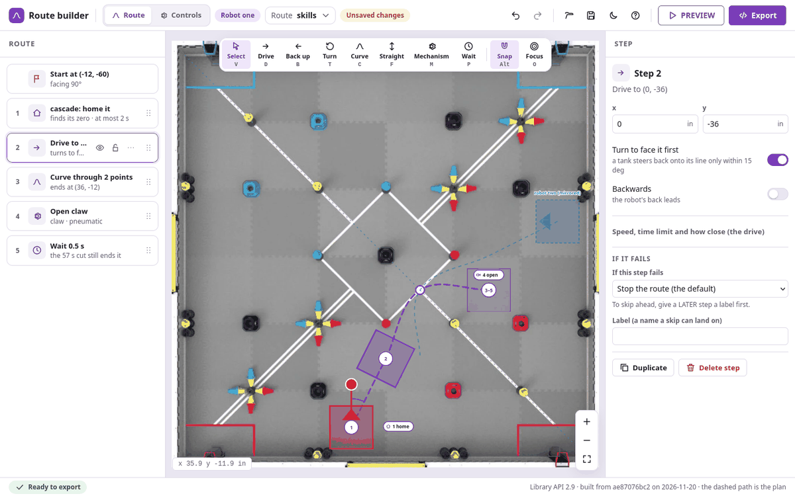

# Route builder

**Do this first:** [Set up your robot first](guide/23-set-up-your-robot-first.md) — Bench Tests and Calibrate on
the robot, before you make a route.

Build your routes — the skills route and any other you name, each picked by its name on the brain's menu — by
clicking on the real field, see at once anything the robot would refuse, and export the C++ for the robot — in the
browser, with nothing to install. Robot two's mirrored start and path are drawn beside robot one's, and when both
robots run a route at the same time the page checks that its plan keeps them 6 in apart. Every change to it is
tested in Edge, Chrome and Firefox on Windows, and in Chromium and Firefox on Linux.

Press **PREVIEW** and the robot drives the route right there: the real library runs it on the host test plant
inside the page, and plays it back on a timeline you can scrub — each step marked done, failed or skipped in the
library's own words, and the mechanisms moving beside the field: the cascade rising and falling, the claw opening,
the toggles running.

A crowded spot, where many steps' points sit on one place, stays easy to work: hide a step, lock it, or focus on one
step and its neighbours ([guide chapter 22, step 10](guide/22-making-your-first-route.md#10-crowded-spots-hide-lock-focus)).

[Open the route builder](route-builder/app.html){ .md-button .md-button--primary }
[Download for offline use](route-builder/shulib-route-builder.html){ .md-button download="shulib-route-builder.html" }

Its **Controls** tab sets the driver's buttons on a picture of the controller and the driving feel — how a small
push and a full push of the stick drive — and exports them into the robot's driver file.

**How to use it, step by step:** [guide chapter 22 — making your first route](guide/22-making-your-first-route.md)
(the buttons and the feel: [its second part](guide/22-making-your-first-route.md#the-drivers-buttons-and-the-driving-feel)).

## Which browser

| Browser | What it does |
|---|---|
| **On the team laptop:** `python3 tools/route_builder.py` (VS Code: **Terminal → Run Task → Open the route builder**) | Any browser, everything, and **Send to robot**: it writes the routes into `src/team/skills_route.cpp`, then builds and uploads them in one button ([guide chapter 22, step 7](guide/22-making-your-first-route.md#7-send-it-to-the-robot)); then **Check the mechanisms**, **Watch the robot** and **What is on robot one** ([the same step](guide/22-making-your-first-route.md#check-the-mechanisms-then-watch-the-run)). |
| **Edge or Chrome** (version 97 or newer) | Everything. Connect your shulib folder once: **Save** writes `src/team/route_maker.json`, **Export** writes the routes into `src/team/skills_route.cpp` (and reads it back) and the **Controls** tab's export into the robot's driver file, each keeping the file's own line endings. |
| **Firefox** (115 or newer) | Everything except writing into the folder: **Save** downloads `route_maker.json`, **Export** copies the code (or hands back an updated `skills_route.cpp`, or driver file, to put in place). |
| **Safari** (16 or newer) — not tested | Should work as Firefox does; no test runs it. |

Edge is on every Windows laptop. A browser older than these says so in a yellow box when the page opens.

## Offline, at the event

On the team laptop, start it once from VS Code (**Open the route builder**) with the internet on before the event: it
keeps the robots' facts and PREVIEW for a venue with none.

**Download for offline use** saves one file, `shulib-route-builder.html` (if your browser opens it instead,
right-click the button and choose **Save link as**). Double-click it — no internet needed. It is the same route
builder, built from the same version of the library as this site. Download it again after an update: an older copy
cannot open a project that uses something added since (it names what it cannot read).

## What it knows

The route builder knows the robots **as of the last time this site was published**: their mechanisms, their
levels, how each one homes, and each robot's driver file (its buttons and feel). The bottom bar says which build of
the library that was. A fact typed into a robot's file reaches the route builder at the next publish; with your
shulib folder connected (Edge or Chrome), the **Controls** tab reads today's driver file instead, and in Firefox its
export checks the driver file you pick.

Opened from VS Code (`tools/route_builder.py`), it knows the robots as this laptop last built the route builder, or
else as the site last published them (kept from a start with the internet on), and it reads today's driver files and
routes from the shulib folder. When this folder's robots differ from the site's, it says **Careful** first.

The dashed path on the field is the **plan** — where the library is told to go. The route builder never draws
its own guess of where the robot will end up.
