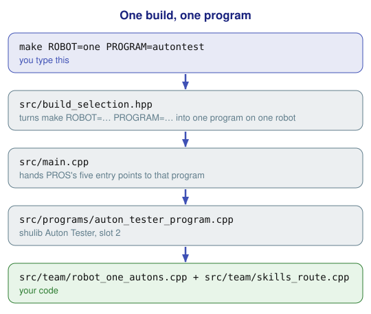

# Where your code goes

Your robot's code lives in **`src/team/`**: the buttons, the autons and the routes. Everything
else under `src/` is the plumbing that runs it. You can read the plumbing, but a route, a button or a
new auton never goes there, and `src/main.cpp` stays short so your own notes in it stand out.

## The folders

| Folder | What is in it | Change it when |
|---|---|---|
| `src/team/` | each robot's driver file (buttons, stick feel), each robot's autons, the routes the route builder exports (`skills_route.cpp`, shared by both robots) | you change how the robot plays |
| `src/robots/` | what each robot is: ports, motor directions, mechanisms, its measured facts | the robot is rebuilt, re-cabled or measured |
| `src/programs/` | the six programs, one file each | a program itself changes |
| `src/common/` | what the programs share: booting, the screens, the plumbing behind every driver file | a program itself changes |
| `src/build_selection.hpp` | turns `make ROBOT=… PROGRAM=…` into one program on one robot | a program or a robot is added |
| `src/main.cpp` | hands PROS's five entry points to that program | a program is added |

## The programs

Robot one's builds. Robot two's are the same with `ROBOT=tank`, and its files are
`src/team/robot_two_driver.hpp` and `src/team/autons.cpp`.

| Build | On the brain | Slot | Program file | The team's and robot's files it uses |
|---|---|---|---|---|
| `make ROBOT=one PROGRAM=drive` | shulib Drive | 1 | `src/programs/drive_program.cpp` | `src/team/robot_one_driver.hpp` |
| `make ROBOT=one PROGRAM=autontest` | shulib Auton Tester | 2 | `src/programs/auton_tester_program.cpp` | `src/team/robot_one_autons.cpp`, `src/team/skills_route.cpp` |
| `make ROBOT=one` | Bench Tests | 3 | `src/programs/bench_r3a.cpp` | none |
| `make ROBOT=one PROGRAM=calibrate` | shulib Calibrate | 4 | `src/programs/calibrate_program.cpp` | `src/robots/calibrate_facts.hpp` |
| `make ROBOT=one PROGRAM=competition` | shulib Competition | 6 | `src/programs/competition_program.cpp` | `src/team/robot_one_autons.cpp`, `src/team/skills_route.cpp`, `src/team/robot_one_driver.hpp` |
| `make ROBOT=one PROGRAM=tune` | shulib Tune | 7 | `src/programs/tune_program.cpp` | `src/robots/mechanism_table.hpp` |

Slot 5 is kept for the team's old code. Upload a build with
`pros upload --slot <slot> --name "<on the brain>"` ([Build and upload the programs](guide/07-getting-set-up.md)).
For the Auton Tester, `python3 tools/upload_auton.py one` (or `two`; `python` on Windows) does both and says plainly
whether it worked.

## What to change, and where

| You want to | Change |
|---|---|
| add or change an auton | `src/team/robot_one_autons.cpp`, and the same in `src/team/autons.cpp` (the suite fails when the two robots' lists differ) |
| add or change a route | the [route builder](route-builder.md) (on the team laptop: VS Code's **Open the route builder** task, then **Send to robot**): **Export** writes every route into `src/team/skills_route.cpp`, and each appears on the brain's menu by its name |
| change a button or the stick feel | `src/team/robot_one_driver.hpp` and `src/team/robot_two_driver.hpp` |
| move a mechanism to another port | `src/robots/robot_one_facts.hpp` ([Add your robot](guide/21-adding-your-robot-by-hand.md)) |
| re-cable the drive | nothing by hand: run shulib Calibrate again with an SD card in the brain; its record beats the typed table ([Calibrate the drive](guide/19-calibrating-your-robot.md)) |
| add a mechanism | `src/robots/mechanism_table.hpp` ([Declare a mechanism](guide/18-mechanisms.md)) |

## What `src/main.cpp` does

PROS calls five functions: `initialize()`, `disabled()`, `competition_initialize()`, `autonomous()`
and `opcontrol()`. In shulib each one is a `switch (kProgram)` with one case per program, and each
case calls that program's function. Before that, `initialize()` does two things:

1. It installs the robot's precondition handler, first, before any device is made. A broken promise
   inside the library then stops the motion and shows on the screen and in the log.
2. It prints one line naming the robot whose tables this build carries:
   `[BLD] robot tables: shulib-robot=robot-one (src/robots/chassis_table.hpp, src/robots/mechanism_table.hpp)`.

There is no robot, no port and no routine in `src/main.cpp`. `autonomous()` never runs a routine
itself: shulib Competition runs the auton picked on its menu, and the Auton Tester runs one when you
touch RUN.

## Adding a program

This is the one change that touches `src/main.cpp`:

1. Add it to `enum class Program` in `src/build_selection.hpp`, with a branch of the one `#if` chain for
   each robot it builds for, and its `PROGRAM=` value in the `Makefile`.
2. Add a case to each of the five switches in `src/main.cpp`. The switches have no `default:`, so the
   build fails until every one has the new case.
3. Add its row to `PROGRAM_ENTRY_SYMBOLS` in `tools/src_build_gate.py`. The gate reads each build's
   symbols and fails a build that calls another program's function.
